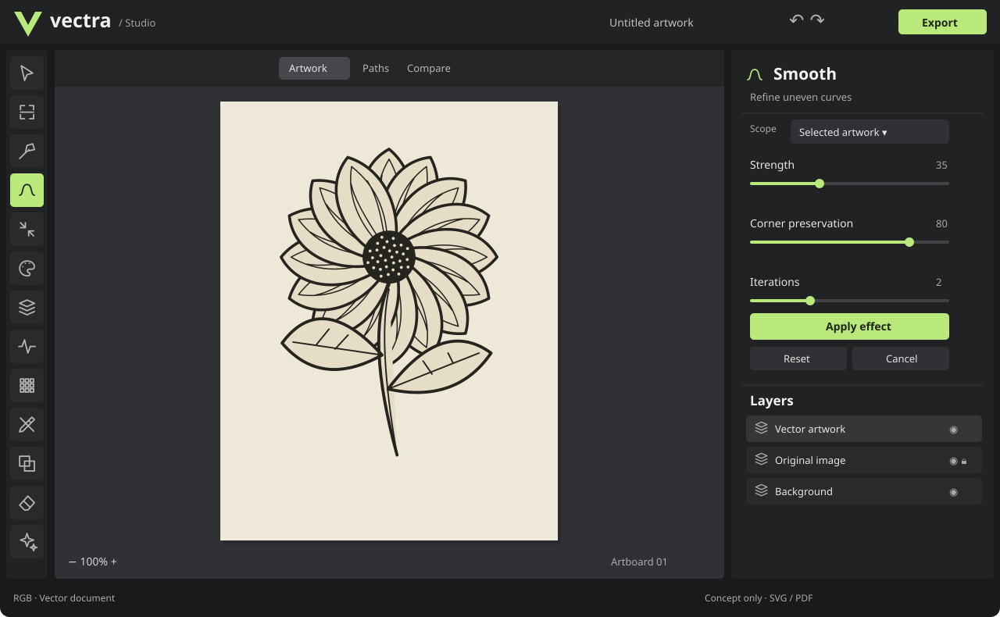
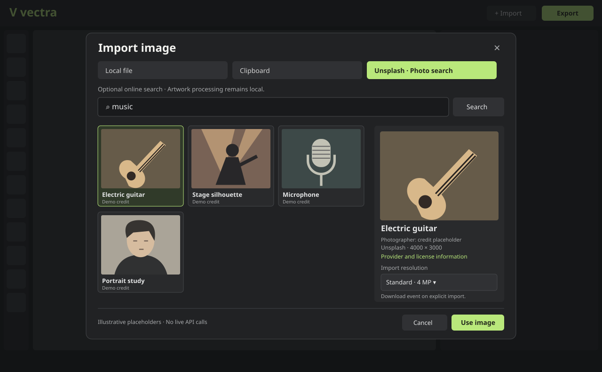

# PRD-002 — Vectra Vector Creation Studio
Status: proposed for maintainer review | 2026-11-23
Related: [PRD](PRD.md), [RFC-001](RFC-001.md), [Preset baseline](PRESETS.md), [Design baseline](DESIGN.md), [Validation](VALIDATION.md), [Tool and style specification](VECTOR-STUDIO-TOOLS.md), [Optional image sources and community presets](IMAGE-SOURCES-AND-COMMUNITY.md), [Creative Lab](CREATIVE-LAB.md).

## Executive summary
Vectra is a small, purpose-built Illustrator-like creative application for importing raster artwork, tracing it into genuine vectors, editing the result and creating expressive print-inspired artwork. Tracing is the beginning of a workflow, not the deliverable. The product remains an open-source, local-first browser app on Cloudflare Pages, with Vite+ and a browser-target WASM core. No account, upload, subscription or backend is required for the core. Vectra is an artist-controlled creative instrument, not an AI image generator: all tracing, geometry editing, print simulations and seeded variations use conventional image processing and procedural algorithms; no inference or generative models are in scope.

This addendum proposes an expanded post-P0 product scope. It supersedes conflicting product/UX priorities in PRD.md and DESIGN.md only after approval; it does not replace RFC-001's export or privacy requirements. Do not interrupt the in-flight P0 proof of concept or interpret this as authorization to start P1.

## Business analysis
| User segment | Job to be done | Current friction | Vectra value |
|---|---|---|---|
| Independent musician / label | Turn a photo into a gritty gig flyer or album graphic | Multiple image-editing and tracing steps | Local, adjustable punk print styles and editable ink layers |
| Zine maker / illustrator | Produce a bold monochrome or newsprint illustration | Raster textures become awkward to edit or scale | Real vector distress, halftones, cutouts and paths |
| Designer / merch artist | Simplify a scanned drawing or graphic for printing | Overtracing creates too many nodes; color changes are tedious | Selective smoothing, simplification, cleanup, palette tools |
| Privacy-sensitive user | Refine private artwork without uploading | Cloud tools may transfer source artwork | All editing and export local to browser |

Alternatives include Illustrator (trace, expand, simplify, recolor), Inkscape (trace, nodes, live path effects), and standalone vectorizers. Vectra is intentionally narrower than a general-purpose editor: fast image-to-vector-to-artwork iteration, strong print character, editable results, no server processing. No market-size, adoption, performance or commercial-print compliance claims are implied.

## Workflow and scope
1. Import a raster file; preserve source locally and display its orientation, alpha and dimensions.
2. Choose Core, Print or DIY Underground preset, tune tracing, compare with original.
3. Commit a trace as editable objects with stable IDs and layer membership.
4. Select an object, group, palette color, layer or entire artwork; refine geometry and color.
5. Add creative effects, adjust parameters, toggle/reorder effects where supported; bake when direct editing requires it.
6. Review vector paths, zoom, inspect complexity and export SVG or vector PDF.
7. Save/reopen a local project when persistence is delivered. No remote storage.

## Requirements and priorities
| ID | Priority / proposed phase | Requirement |
|---|---|---|
| VS-01 | Must P1-A | Editable scene: objects, groups, layers, stable IDs, selection, transforms, visibility and locking |
| VS-02 | Must P1-A | Undo/redo for committed edits, including transform, deletion and trace replacement |
| VS-03 | Must P1-B | Compact left Lucide icon rail, central canvas, contextual right inspector, top project/export bar |
| VS-04 | Must P1-B | Artwork, Paths and Original/Compare views; zoom/pan/fit, selection highlight and keyboard navigation |
| VS-05 | Must P1-C | Core tracing, smoothing and simplification as distinct tools, cleanup, fill/palette editing |
| VS-06 | Must P1-C | Genuine SVG and PDF export of final evaluated vector scene; no raster fallback |
| VS-07 | Should P2-A | Anchor and handle editing, boolean operations, offset paths and compound paths |
| VS-08 | Must P2-B | Versioned, non-destructive effect stacks; enable/disable, adjust, reorder subject to dependencies, bake |
| VS-09 | Must P2-C | Initial Print and DIY Underground style family; artistic output remains vector geometry |
| VS-10 | Should P2-C | User presets and deterministic seeds; same source/recipe/seed reproduce result within documented runtime |
| VS-11 | Should P3 | Advanced engraving, carve, stipple, geometric abstraction and stencil |
| VS-12 | Should P4 | Local .vectra project round trip, batch and validated professional print features |
| VS-13 | Should post-core | Local preset import/export, versioned recipes and optional static community library with moderated submissions |
| VS-14 | Could post-core | Optional online image provider browser, Unsplash first, subject to policy, privacy and feasibility gates |
| VS-15 | Must all phases | No AI in the creative runtime; deterministic conventional algorithms and procedural vector generation |
| VS-16 | Should P2-C/P3 | Virtual Printing Press with independently editable ink plates and procedural print effects |
| VS-17 | Should P2-C/P3 | Variation Lab with locked parameters, deterministic seeds, compare and explicit apply |
| VS-18 | Should P2-C/P3 | Modular typed Recipe Builder and compatible community preset export |
| VS-19 | Could P3 | Procedural Pattern Lab and Vector Glitch Lab |
| VS-20 | Could P3/P4 | Artistic geometry brushes, multi-source collage, print preview and preflight |

P1 is the minimum usable studio, not the full flagship release. P2-C establishes the creative differentiator. Persisting projects may move earlier if owner prioritizes continuity; P1 must warn about unsaved changes and offer export. No full typography, multi-page publishing, 3D, general painting, SVG import of arbitrary active content, AI redraw or cloud collaboration in initial scope.

## Interaction model
Default to the Selection tool after a trace is committed. Left rail changes the inspector without applying edits; selection remains intact. Tools distinguish live preview from committed state, offer Apply/Cancel/Reset and report scope. Disabled tools explain why (e.g. boolean operation needs two objects). Selection scope is explicit: selected objects, layer or entire artwork. Source raster is locked/reference-only by default and excluded from vector exports. A new trace must never silently replace manually edited paths: offer new layer or explicit replace with undo. Direct node edits on an evaluated stack require explicit bake or editing the base object; no silent discard.

## Approved-direction mockup (reconstructed for review)

[Interactive HTML mockup](mockups/vectra-workspace.html) — download/open locally in a browser; GitHub does not execute HTML previews. Reconstructs the owner-liked dark charcoal workspace with lime accent, ivory artboard, narrow left icon rail, context-sensitive right inspector, layer list, and top export controls. Botanical artwork is an original schematic placeholder rather than the earlier chat's reference image; no tracing/rendering is implemented. The SVG is a static reference and HTML is an interaction prototype, not production code. No remote assets or libraries.

### Optional image import and photo search

The interactive HTML mockup also includes an Import dialog with Local file, Clipboard and Unsplash tabs, searchable illustrative fixtures, selection and metadata preview, resolution options, and simulated handoff to Image Trace. No live API calls, credentials, actual photo credits or image processing are included. The static SVG illustrates the same dialog. See [image sources and community specification](IMAGE-SOURCES-AND-COMMUNITY.md) for production requirements.

### Layout
Desktop target: 48–56 px left rail, flexible central canvas, 288–336 px right inspector, compact top bar and bottom status/zoom. Widths are proposals to test. Inspector scrolls independently; collapsible Layers and Effects sections; right panel collapses on smaller screens. Canvas should stay central. Prefer dark neutral surfaces (#191a1c / #212224), lime #b9e87b active accent, warm ivory #eee8d8 optional paper preview. Paper preview must not silently add a background to export. Focus rings, tooltips, aria-labels, keyboard shortcuts and numeric inputs required. No color-only statuses.

## Acceptance scenarios
- Given two closed shapes, selecting one then smoothing it changes only that path; corners/holes preserved unless explicitly authorized; undo restores exact previous document.
- Given an overtraced circle, simplification reduces node count and reports tolerance/observed deviation; no silent topology change. Cancel restores original.
- Given artwork with repeated fills, replace color across selected scope; unaffected layers unchanged; preview equals export.
- Given a punk photo, apply Copy of a Copy with fixed seed, adjust generation count, undo, and export; output is genuine geometry, reproducible, and within declared complexity limits.
- Given a committed effect stack, toggling an effect updates preview; stale jobs cannot overwrite newer revisions; baking preserves appearance within validated tolerance.
- Given a locked source and hidden layer, exported SVG/PDF excludes both; explicit background option respected; no images embedded.
- Given keyboard-only use, change tools, select objects, edit inspector values, apply/cancel, undo and export with visible focus.
- Given malformed input or resource cap, stop with a recoverable warning; no silent downsampling/rasterization.

## Proposed success measures (not measured)
- First successful import → edited artwork → export in a moderated usability test; record completion/time/errors.
- Core geometry correctness using synthetic holes, corners, curves, and multi-object fixtures; record node counts and deviation.
- Artistic review by owner across portrait, musician photo, logo and illustration (licensed fixtures), comparing multiple settings and styles, not just a single thumbnail.
- Responsive pan/zoom and edits on agreed reference hardware; establish targets from P0 then benchmark complex scenes.
- Zero raster images in both SVG and PDF; independent render agreement; privacy tests from VALIDATION.md.

## Delivery sequence
P0 unchanged. After P0 review, write RFC-002 with editor state and command/geometry contracts, then P1-A document/selection/history, P1-B production workspace, P1-C core editing/export, P2-A advanced geometry, P2-B effects, P2-C Print/DIY Underground, P3 advanced effects, P4 project persistence/print/batch. Review scope and adjust sequencing after prototype evidence. Each phase needs a gate report, tests, screenshots and owner review. No dependency or gate is approved merely by appearing in this PR.

## Future creative ecosystem
The Import panel may offer Local file, Clipboard and optional Browse images (Unsplash first). A community preset website may support browsing, downloading, remixing and submitting recipes. These are optional extensions, not required for local editing. Any credential-protecting Cloudflare Worker/Pages Function is an isolated online adapter, not an artwork-processing backend. Online requests and provider tracking must be disclosed; the original no-network guarantee applies to the local core. See [image sources and community specification](IMAGE-SOURCES-AND-COMMUNITY.md) for requirements, research, licensing and acceptance gates. No changes to current P0 scope.

## Creative Lab direction
The [Creative Lab specification](CREATIVE-LAB.md) expands the post-core roadmap with a virtual printing press, seeded Variation Lab, procedural pattern and glitch tools, modular recipe builder, artistic vector brushes, collage and print preview. The flagship combination is DIY Underground + Printing Press + Variation Lab + shareable recipes. No AI or neural runtime dependencies; creative control remains with the user. Effects are conventional and deterministic where seeded, and exported SVG/PDF remain genuine vector geometry. Exact scope is phased and subject to P0 evidence. No changes to current P0 scope.
