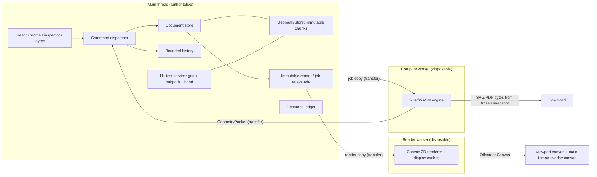

# RFC-002 — Vector Studio architecture

**Status:** APPROVED (G-0 closed, 2026-11-25). The maintainer approved this reconciled RFC, the contracts C1–C9 (with the G-0 closure clarifications to C2, C3, C5, C7 and C8 integrated) and the gate plan. Architecture is **frozen**: changes need an amendment ([contracts](research/g0/G0-ARCHITECTURE-CONTRACTS.md), change control). P1-A (G-ENG, G-DOC) is authorised after P-CI.

| | |
|---|---|
| Date | 2026-11-25 |
| Baseline | `main` `baf1d17` (accepted P0, PR #3) |
| Draft | `0e32fda` (PR #4) |
| Independent review | PR #6, head `91552aa`; recommendation "READY SUBJECT TO SPECIFIED AMENDMENTS" (accepted) |
| Reconciliation | G-0; records in [research/g0/](research/g0/G0-FINAL-REPORT.md) |

**Scope:**
- the P1 editor foundation;
- explicit seams for P2–P4;
- normative cross-module contracts, consolidated in [G0-ARCHITECTURE-CONTRACTS](research/g0/G0-ARCHITECTURE-CONTRACTS.md);
- the gate plan in [G0-P1-IMPLEMENTATION-PLAN](research/g0/G0-P1-IMPLEMENTATION-PLAN.md).

**Inputs:**
- [P1 handoff](P1-HANDOFF.md), [RFC-001](RFC-001.md), [PRD-002](PRD-002-VECTOR-STUDIO.md), [tools](VECTOR-STUDIO-TOOLS.md), [Creative Lab](CREATIVE-LAB.md), [design system](DESIGN-SYSTEM.md);
- [technical debt](TECHNICAL-DEBT.md), [P0 acceptance](research/P0-ACCEPTANCE.md);
- the [independent review](research/rfc-002-review/FINAL-REPORT.md), a historical evidence record that is not edited by G-0.

Normative keywords: **must** / **must not** / **should** / **may**.

**Evidence labels.** "measured" means executed in P0/P0-R/P0-R-GEO or in the independent review. Review timings were taken under unrelated background CPU load (12–14 `ngspice` processes, load average ≈ 13–16 on 18 cores), so they are **not** clean reference-machine measurements.

**Architecture vs implementation.** Every decision below is an *accepted architecture*. **None is a validated production implementation**; qualification happens in the gates of §19.

## 1. Decision summary
| ID | Decision | Status |
|---|---|---|
| D01 | **Ownership.** The main application thread owns the authoritative document. Committed geometry lives in immutable **chunks** owned privately by a copy-out-only **GeometryStore** (§5). React is a view | Accepted (A1, A2) |
| D02 | **Commands and history.** Transactional commands with monotonic revisions; bounded structural-sharing history accounted in chunk bytes; keyboard edits coalesced (§7) | Accepted (A13) |
| D03 | **Geometry contract.** **GeometryPacket v1** is the sole editor geometry transport and storage representation. Scene v1 JSON is kept only for interchange and export adapters (§6) | Accepted (A3–A5, A15) |
| D04 | **Rendering.** Retained **Canvas 2D**, with four mandatory parts: a display-only gesture cache, an OffscreenCanvas render-worker host, linear path construction, and renderer-independent geometric hit testing. Read-only snapshot consumer (§8) | Accepted with qualifications (A6, A7, A20) |
| D05 | **Compute and scheduling.** One disposable compute worker plus the normative scheduler contract: only previews are pre-emptible; fail-closed protocol (§10) | Accepted (A8, A9) |
| D06 | **Shared boundaries.** A trace-local shared-boundary graph in Rust, released as opt-in **Precision v2**; independent paths materialised at commit (§12) | Accepted with qualifications (A11) |
| D07 | **Recipes.** Typed linear recipes with side inputs, composite outputs and stable seeds (§13) | Accepted (A12) |
| D08 | **Persistence.** Bounded `.vectra` container v1; serializer in P1-A, Save/Open UI in P1-C; no autosave (§14) | Accepted (A14) |
| D09 | **UI foundation.** Vite+, React, TypeScript, Tailwind, shadcn/ui + Dice UI on Base UI, Lucide, at the qualified pins with owned patches and accessibility fixes (§16) | Accepted with qualifications (A16) |
| D10 | **Hosting.** Workers Static Assets plus a versioned service worker; single-build sessions; online adapters only in a separate build variant (§15) | Accepted (A19) |

Performance budgets (§17) are accepted **provisionally** (A17). The gate plan (§19) is accepted (A18). The amendment-by-amendment trace is in [G0-TRACEABILITY-MATRIX](research/g0/G0-TRACEABILITY-MATRIX.md).

## 2. Non-negotiable principles
1. **What Vectra is.** An artist-controlled vector graphics and creative printmaking studio, not merely an image-to-SVG converter.
2. **Local processing.** All artwork processing is local. There are no external artwork-processing services, and no artwork upload as part of core processing.
3. **No AI.** No AI inference, ML models, inference APIs or AI-dependent runtime features.
4. **Conventional methods.** The foundation is deterministic image processing, computational geometry and procedural algorithms.
5. **MIT core.** `Copyright (c) 2026 Stephane Pericat` (verified in `LICENSE` at G-0).
6. **Free core.** No mandatory accounts, subscriptions, watermarks, export quotas or paid engine capabilities.
7. **Genuine vectors.** SVG and PDF exports contain genuine vector geometry with **no raster fallback**.
8. **Display caches are disposable.** Raster display caches are never authoritative geometry and never enter exports.
9. **Online isolation.** Optional online integrations are isolated from the core, in a separate build variant (§15).
10. **Artist control.** Creative operations are reproducible, inspectable and controllable by the artist.
11. **Architectural requirements.** Privacy, offline operation, accessibility and responsiveness are requirements, not polish.

Approved P0 behaviour is preserved:
- **Artistic** (spline) stays the default fit.
- **Precision v1** stays explicitly selected and reproducible.
- The 326 regression hashes and 72 bundle-v2 hashes are frozen.

## 3. What exists (baseline, source-inspected)
- **`crates/vector-engine/src/scene.rs`.** Scene v1: ordered groups, palette, optional background, rect group clips, and compound paths (M/L/C/Z verbs string plus f64 coordinates) with fill/stroke and an explicit fill rule. No object IDs or transforms. Validation covers structure and anchors (|v| ≤ 1e6, anchor budget).
- **`packages/vector-engine-wasm/src/lib.rs`.** `vectorize` returns scene JSON, a report and SVG; `sceneToSvg` and `sceneToPdf` take scene JSON. Strings are cloned in linear memory (`getter_with_clone`) and decoded into JS strings.
- **`src/vectorization/client.ts`.**
  - One pending job, latest-wins traces, generation guards, terminate/recycle above 1 GiB.
  - `exportPdf` rejects with `busy` while a trace runs, and `trace()` terminates the worker even while it is still starting.
  - Both behaviours are superseded by §10.
- **`src/workspace/useWorkbench.ts`.** Copies RGBA for transfer, uses a 200 ms debounce, and previews through an SVG Blob `` (the TD-PERF-001 freeze).
- **`scripts/generate-sw.mjs`.** Content-versioned precache, no `skipWaiting`, old caches deleted on activation, navigations network-first. The last point allows version skew (§15.3).
- **Measured at P0-R** (M5 Max):
  - native 12–24 MP colour traces take 5–12 s;
  - 8 of 28 runs exceeded 1M anchors only after the full trace;
  - preview frame gaps of 83–850 ms;
  - WASM memory up to 972 MiB.

## 4. Architecture and module ownership


**Contexts.**
- **Main thread.** Owns the document, history, GeometryStore, resource ledger, hit-test service and UI. It is the **only** authority.
- **Compute worker.** One disposable WASM worker for tracing, geometry operations and exports. It holds only job inputs, intermediate caches and WASM linear memory, all disposable.
- **Render worker.** Hosts the Canvas 2D renderer on an OffscreenCanvas. It holds only a disposable render copy of the packets of the visible snapshot, Path2D objects and display caches.

**Loss handling.**
- **Losing either worker** loses no committed state. The compute worker's in-flight job fails or is requeued (§10). The render worker is rebuilt from the current snapshot (§8.6).
- **Losing the page** loses unsaved work. Explicit Save (§14) is the only persistence in P1.

**Module layout.**
```text
src/document/      (store, commands, history, GeometryStore, IDs, serializer)
src/evaluation/    (snapshots, packet adapters, op descriptors, caches)
src/workers/       (protocol, compute client, scheduler)
src/renderer/      (render-worker host, renderer, caches, overlay)
src/hit/           (hit-test service)
src/workspace/     (controller, tools, inspectors, layers)
src/components/ui/ (owned registry sources)
src/components/editor/
src/projects/, src/export/, src/presets/, src/styles/
```
- `src/renderer/` must not import document **mutation** APIs (§8.7).
- The Rust trace adapter, validated scene and writers stay engine-internal.
- No speculative monorepo split.
- State uses a framework-neutral TS store with narrow selectors (`useSyncExternalStore`). No per-anchor React state and no per-pointer deep clones. Zustand is not adopted unless a need is shown.
- Single user, single document, one artboard. No CRDT, collaboration or plugin host.
- Paper.js, Kurbo and Clipper2 are candidates only, **not approved dependencies**. Any adoption needs a measured rationale and a licence check in its gate.

## 5. Document and geometry ownership
### 5.1 Document v1 (logical schema)
Document, packet, scene, recipe, protocol and container versions are **independent**.

```text
Document { documentSchemaVersion, documentId, revision /* session only */, nextId, nextChunkId,
           artboard, orderedRootIds, nodesById, paletteById, sourceAssetsById }
Node       = Layer | Group | PathObject | SourceReference
Common     { id, name, visible, locked, localTransform /* 2×3 f64 */, clipRef? }
Layer/Group{ orderedChildIds, effectStack? }
PathObject { geometry: { chunkId, pathIndex }, styleRef, fillRule, effectStack? }
SourceReference { assetId, sourceToDocument /* 2×3 f64 */, traceProvenance? }
SourceAsset{ id, digest /* SHA-256, REQUIRED */, mime, width, height,
             decodePolicy, embedded: bool, provenance? }
TraceProvenance { traceRequest, engineVersion, fitMode, precisionFitVersion?,
                  sourceDigest, chunkId }
```

**Invariants** (validated on every commit and on load):
- an acyclic ordered tree, with one parent per non-root;
- unique IDs, and `nextId` greater than every allocated ID;
- every reference resolves (chunks, styles, palette, assets, clips);
- finite, bounded numbers; transforms finite and non-singular (condition-number tolerance specified in G-DOC);
- clipped nodes are Layers or Groups whose composed transform is axis-preserving (C8);
- document anchors, counted **per PathObject reference**, within the product cap (§8.8, C3.2);
- depth and size caps.

**Persistence of these fields.** `revision` is session-scoped and not persisted. The high-water marks `nextId` and `nextChunkId` are persisted (C7). They sit outside undoable state and never move backwards (C1).

**Visibility and lock.**
- Visibility and lock inherit down the tree.
- Hidden nodes do not export; locked visible nodes do.
- The source reference is locked by default and never exported as raster.

**Colour authority.** A palette reference or a literal fill is the single colour authority; the evaluated scene materialises the validated colour.

**Authority after commit** (contract C3.1):
- A packet's style table, fill rules and group table are **commit-time inputs and provenance only**.
- On commit, each packet group becomes a Group node (its clip a rect `clipRef`) under a new Layer, and each path becomes a PathObject `{chunkId, pathIndex}` with a document `styleRef` and `fillRule` derived from the packet.
- From then on **the document is authoritative** for style, fill rule, transform, visibility, lock, order and clips.
- Renderers and exporters receive these **effective** values in snapshots and never read packet style tables as authority.

**Not supported:** arbitrary SVG import, text, filters, gradients.

**IDs.**
- Monotonic document-local IDs with a kind prefix. The high-water mark survives undo and redo.
- Duplicate gets fresh IDs. Undo restores identity but increments the revision.
- Traced objects are allocated in deterministic paint order.
- Compound paths and holes are preserved. Splitting requires an explicit, containment-checked command.
- Retracing after edits defaults to a **new layer**; explicit replacement is undoable.
- A re-evaluated recipe preserves the parent's identity. Child IDs are stable only where operation-local identity is well defined; otherwise selection returns to the parent.
- **No** index-based durable identity and **no** heuristic topology matching.

**Coordinates.**
- y down, in source-pixel units initially, f64.
- Composition is parent × local through 2×3 affine matrices; camera and DPR are separate.
- Coordinates are rounded only at serialization boundaries. Unedited P0 trace coordinates are retained bit for bit.
- Physical output size is independent of zoom.
- Non-uniform stroke transforms need qualified outline expansion, or are rejected; widths are never silently averaged. P1 uses filled paths first.

### 5.2 GeometryStore (normative ownership and lifetime)
The authoritative contract is [G0-ARCHITECTURE-CONTRACTS §C2](research/g0/G0-ARCHITECTURE-CONTRACTS.md).

**Ownership and access.**
- **Ownership.** The store privately owns every committed chunk's `ArrayBuffer`s.
- **Access.** Readers receive a read-only view wrapper. **No API returns a committed `ArrayBuffer` or a typed array over one** in a form that could enter a transfer list.
- **Commit** runs in four steps, in this order:
  1. **Shape check.** The input must be six whole-buffer arrays over distinct, non-shared, non-resizable `ArrayBuffer`s.
  2. **Move.** The store takes the buffers with `structuredClone(…, { transfer })`. Every caller alias is detached, and nothing is copied.
  3. **Validate.** C3 validation runs on the **store-owned** bytes, deriving metadata in the same pass. There is no pre-validated fast path.
  4. **Publish** under a stable, never-reused `chunkId`.

  Validate, then mutate, then commit is therefore impossible. TypeScript `readonly` is not relied on. Commit consumes its input even on failure, and never copies implicitly: callers holding views use the explicit `copyIncoming()`. A fail-closed startup check verifies a little-endian host and detaching transfer. (C2)
- **Copy-out.**
  - `jobCopy(chunkIds)` returns fresh buffers for a worker job.
  - `renderCopy(snapshot)` returns fresh buffers for the render worker.
  - These are the **only** routes to a transfer list.
  - Render copies are driven by the renderer host, never by commands. Legitimate triggers are initial cache population, render-worker recovery, and a new chunk entering a snapshot.

**Lifetime.**
- **Owners.** A chunk is retained by any of four owner kinds: the current document, a history entry, a frozen snapshot (export, render, job), or a pending job. Each owner kind is reference-counted.
- **Release.** A chunk is released only when its count reaches zero. Release is deterministic, at transaction end or job settle.
- **No copies for cheap edits.** Transforms, recolouring, visibility, reordering, grouping and other structural commands **never** copy geometry.
- **New chunks** come only from a trace commit, a bake, or a geometry operation; one chunk per result, containing only the affected objects.
- **Accounting.** The store reports exact bytes by owner kind to the resource ledger (§11.3), per C3.2:
  - each chunk is counted once and attributed to its highest-precedence owner (document > snapshot > job > history), so the kinds sum to the total;
  - copies are charged to their job or render-worker entries.
- **Compaction** of heavily edited documents is a later, explicit operation. It is never implicit.
- **Enforcement.** Tests assert that no committed buffer is ever detached. Evidence: transferring a committed buffer by mistake silently sets `byteLength` to 0 (measured, review R01).

## 6. Geometry contract: GeometryPacket v1
**Normative.** GeometryPacket v1 is the **only** representation of geometry in editor transport (worker ↔ main), in storage (GeometryStore chunks) and in persistence (§14). There is **no JSON fallback**.

Scene v1 JSON remains the engine's interchange and export-adapter format. Export runs as: frozen snapshot (draw list plus chunk job copies) → Rust `bake_draw_list` → scene v1 → the SVG/PDF writers (§6.1, C3.1).

The byte-level contract is in [G0-ARCHITECTURE-CONTRACTS §C3](research/g0/G0-ARCHITECTURE-CONTRACTS.md). Summary:

**Fields and encodings.**

| Field | Type | Count |
|---|---|---|
| verbs | `u8` (M=0, L=1, C=2, Z=3) | verbCount |
| coords | `f64` IEEE-754 | coordCount |
| verbOffsets, coordOffsets | `u32` | pathCount+1, with sentinels |
| styleIndex | `u32` | pathCount |
| groupIndex | `u32`, non-decreasing in paint order | pathCount |

- The manifest carries `packetVersion: 1`, artboard size, counts, a style table and a group table (rect clips only).
- **In memory**, arrays use platform order (little-endian on every supported target).
- **On disk and in any byte serialization**, arrays are **little-endian**, each section aligned to 8 bytes with zero padding. Section offsets are computed from the manifest counts, never stored (C3.0).

**Validation** happens once, at every trust boundary: worker → main, file → store, main → WASM. For worker → main and file → store, that boundary is `GeometryStore.commit`, which validates the bytes it already owns (§5.2).
1. **Manifest budget check before any allocation**: exact, checked size arithmetic (u64 in Rust, because wasm32 `usize` is 32-bit; integer and range checks in TS). The check covers the in-memory size plus the derived-metadata upper bound, and the manifest length for byte streams (C3.2).
2. Types and lengths; offsets monotonic, **in bounds before iteration**, with exact sentinels.
3. Opcode range; grammar (segments need an open subpath); exact arity.
4. Finite coordinates with |v| ≤ 1e6.
5. Style and group references in range; group order non-decreasing.
6. Anchor budget.

**Derived metadata.** Per-path bounds, subpath starts and the anchor count are **derived** in that single validation pass and **never transported** (A4).

**Determinism.**
- Native and WASM builds of the engine produce byte-identical packets for identical input.
- The TS and Rust validators share one adversarial fixture suite: the 27 review cases are the seed, kept in a shared fixture directory (G-ENG), and both validators must agree case by case.

**Boundary hygiene.**
- No VTracer or visioncortex types cross any public engine interface (TD-ARCH-001).
- The packet carries no object IDs, transforms, plates or clips beyond group rects. Those belong to the document.

### 6.1 Export (draft §6 rules, retained)
**Source of truth.**
- Export runs only on request, from the **exact frozen committed revision**: visible nodes only, at the approved physical size.
- The export job carries a draw list (effective transform, style, fill rule, clip; visible nodes only) plus job copies of the referenced chunks (C5). Rust bakes the transforms in f64 and builds a scene v1 for the writers.
- **Unedited P0 route.** Identity transforms and unchanged styles preserve the original coordinates, metadata and hashes.
- Edited exports carry deterministic metadata, excluding file names, clocks and ephemeral IDs.

**Preview vs final.**
- Preview resolution is **never silently exported as final**. The UI shows exact vs draft and offers final evaluation or the last committed result.
- Exports exclude sources, guides, selection, checkerboard, the paper display tone and any raster display cache.

**Writers.**
- SVG and the direct Rust PDF writer consume **one** validated scene.
- **No** SVG→PDF conversion, **no** silent unsupported operations, and **no** CMYK, PDF/X or spot-colour certification claims.
- Independent renderer checks and vector-resource inspection remain mandatory (`verify-exports.mjs`).

**Scene versions.** Scene v2 only for a needed capability (path clips, clip stacks, qualified strokes), with explicit version validation and dual-format regression.

**Legacy API.** The existing `vectorize`, `sceneToSvg` and `sceneToPdf` stay until equivalent packet-route regressions pass (G-EXP).

**Measured basis** (review R01, under background load):
- the packet is −21 % to +15 % of the JSON size, and 2–11 % larger when deflated;
- main-thread JSON.parse costs 97–198 ms at ~1M anchors, against 8–20 ms to validate a packet;
- a transferred packet is delivered in 0–10 ms;
- the wasm-bindgen copy-out costs ~1.6 ms per 45 MB (equivalent measurement).

## 7. Commands and history
**Commands** are pure and validated before publication:
- attach a source;
- commit a trace as a new layer, or explicitly replace one;
- delete, duplicate, reorder, reparent;
- visibility, lock, name;
- transform;
- fill or palette changes;
- group and ungroup;
- artboard changes;
- apply a qualified geometry operation;
- bake.

**Async results** carry `{documentRevision, targetIds, chunk/source digests}`.
- **Previews.** A stale preview result is discarded silently, using a conservative whole-document revision match.
- **Explicit jobs** (final trace, Apply, export) are never discarded silently. A stale explicit result receives a visible typed outcome (§10.3 rule 3b).
- **No half commits.** A failed or cancelled trace or import leaves the document unchanged.

**Gestures.**
- Drags are transient until pointer-up or Apply: one history entry; Escape cancels.
- **Keyboard parameter edits** (arrow keys on sliders or numeric fields) are coalesced: consecutive commits to the same parameter, within a window or until focus changes, form **one** entry (A13). Base UI commits on every key (measured, R05-A).

**History.**
- Selection and camera are not history.
- Undo and redo restore immutable references.
- Revisions are monotonic even across undo, and a new edit clears redo.
- The dirty state reflects saved content identity, not the revision counter. It is computed as **state identity**: `currentState !== savedState`, O(1) and with no per-edit hashing. Undo back to the saved state is clean, and high-water marks do not affect it (C7).

**History budget:** 100 transactions **and** 128 MiB of unique history-only bytes (64 MiB in the constrained profile).
- Bytes are counted by chunk and source owner (§5.2).
- Oldest whole transactions are evicted with visible truncation. The current document is never evicted.
- A command that cannot fit is either rejected, or committed without history after explicit confirmation.
- Undoing a source removal retains the source Blob in history, counted against this budget.

## 8. Rendering (D04)
### 8.1 Decision
Retained **Canvas 2D** is the production renderer. SVG DOM and the P0 SVG-image preview are rejected for production. WebGL2/WebGPU are documented revisit paths (§8.8).

Basis (review R02):
- 4 candidates, 3 engines, 17k–1M anchors;
- 84 correctness renders with 0 geometry-error pixels;
- the display cache and the OffscreenCanvas host were measured together.

### 8.2 Mandatory components (not optimisations)
1. **Display-only raster cache during gestures.**
   - Pan and zoom blit the last exact frame. An exact redraw follows on settle.
   - Measured: gesture p95 17–23 ms in all engines up to 1M anchors, against up to 783 ms per frame without it.
2. **OffscreenCanvas render-worker host.**
   - Path construction and exact redraws run off the main thread. Measured: main-thread gaps 17–19 ms during load and gestures, against 82–1,313 ms on the main thread.
   - The **main-thread fallback** is the *same* renderer on the main thread with the cache. Measured gestures there: 17–22 ms. Settle redraws on the main thread **block** (31–213 ms measured).
   - Use of the fallback is **disclosed** in the UI and diagnostics. It applies when worker OffscreenCanvas 2D is unavailable, or when its presentation latency fails qualification (WebKit risk TD-REN-002).
3. **Linear Path2D construction.** Paths are built from SVG path data, or by qualified chunked `addPath`. **Never** build one large path incrementally with `moveTo`/`bezierCurveTo`: Chromium 159 does this in quadratic time (16.9 s for a 250k-anchor path, measured). A scaling regression benchmark is part of G-R0.
4. **Renderer-independent geometric hit testing** (§9).

Also mandatory:
- **Progressive first frame.** Draw paths in paint order as they are built.
- **Layered caches for object drags** (§8.4).
- **Immutable render snapshots** (§8.5).
- **Revision-aware cache invalidation.**
- **Bounded cache memory**, charged to the ledger.
- **Correct DPR handling.** Backing size = CSS size × DPR, recomputed on DPR change; caches are keyed by DPR. DPR, viewport, path, tile and GPU memory are bounded.
- **Culling.** Conservative transformed bounds, including stroke and clip extents; cull viewport-invisible items while preserving paint order. Expensive build, index and render work is chunked so first feedback never waits for the whole scene. Pan and zoom never retrace.
- **Distinct frame kinds.** Cached *interaction frames* and exact *settled frames* are distinct states that the renderer exposes, e.g. for a "rendering…" indicator and for tests.

### 8.3 Frame semantics
An **exact settled frame** is drawn from vector data at the current camera and DPR. Only exact frames are used for:
- correctness tests;
- owner visual review;
- any statement about rendering fidelity.

**Interaction frames** may be resampled, stale at the edges, or blurred during zoom. They must never be captured, exported or treated as geometry.

### 8.4 Layered drag caches (qualification required)
Object drags must not redraw the whole scene per frame. Exact redraws there are as slow as exact frames: Firefox measured 467–917 ms per frame on halftones.

The cache segmentation **must preserve compositing semantics**:
- paint order;
- alpha;
- clips;
- nested groups;
- visibility and lock.

**Do not** assume that flattening all unselected objects into one background and drawing the selection on top preserves paint order. It does not when the selection sits *within* the paint order.

Minimum correct segmentation: `below-selection` cache, then the live selection, then an `above-selection` cache, per contiguous paint-order run. A non-contiguous selection needs either additional segments or a fallback to exact redraw for the runs between selections.

G-R1 must qualify, against exact frames:
- arbitrary selection positions in the paint order;
- non-contiguous multi-selection;
- overlapping opaque and translucent objects;
- clipping;
- nested groups;
- visibility and lock;
- transform handles;
- palette changes;
- invalidation during document edits.

If the two-layer form is insufficient, refine the segmentation. **Never** accept incorrect rendering.

### 8.5 Snapshots and invalidation
The renderer receives **immutable render snapshots**:
- `{renderRevision, documentRevision, ordered draw list (chunkId, pathIndex, effective transform, effective style, fill rule, effective clip run; visible, not fully clipped items only), dpr, camera}` (C8);
- plus packet render copies for chunks it does not hold.

Caches are keyed by `(chunkId, style, transform, dpr)` and invalidated by revision diff. Messages from a stale `renderRevision` are dropped.

### 8.6 Recovery
- If the render worker or its context is lost, it is recreated from the current snapshot, with no loss of committed state. The main thread shows the last presented frame until the first new frame.
- Worker loss and recreation is a G-R0 test.

### 8.7 Geometry authority (A20)
The renderer is a read-only consumer of snapshots. It **must not**:
- mutate the document;
- own authoritative geometry;
- import document mutation APIs;
- generate exports;
- replace geometric hit testing with pixel-based approximation.

This is enforced by an architectural test or lint rule: `src/renderer/**` may import only the snapshot and packet *read* types (G-R0).

### 8.8 Limits and scoping (A17, provisional)
| Limit | Applies to | Nature |
|---|---|---|
| 1,000,000 anchors | **Per document** (all committed geometry referenced by the current document, visible or hidden, all layers), **per job result**, and therefore per evaluated export scene | **Hard product cap**, enforced before commit. The engine's 5M limit stays engineering-only |
| 250,000 anchors **and** ~40,000 paths | Per **rendered snapshot** (visible geometry) | **Interactive performance target**, not an editing limit. Beyond it the UI warns and shows the "rendering…" state for settled frames |
| 500,000–1,000,000 anchors | Per rendered snapshot | **Stress workload** for qualification |
| Render-worker copy | Per rendered snapshot | Additional memory, provisionally 45–52 MB per 1M anchors plus Path2D and caches, charged to the ledger |

**Anchors count per reference** (C3.2):
- document anchors are the sum over every PathObject of its referenced path's anchors;
- geometry shared by several PathObjects (for example, after duplicate) counts once per reference;
- storage deduplication never lets the evaluated document or an export exceed the cap;
- commands that can raise the count are checked before commit.

History-retained geometry does not count against the anchor cap; it counts against the history byte budget (§7).

These caps are revisited with evidence, for example for collage (CL-07). They are never lowered silently.

**Revisit conditions** for WebGL2/WebGPU, behind the same renderer port (no new comparison project unless one triggers):
1. After the mandatory components, exact settle or edit redraw at ≤ 250k misses budget on real Safari, Firefox or the lower-end device.
2. Creative Lab live previews need per-frame exact redraw of more than 500k marks.
3. Firefox's worker canvas stays CPU-raster for large paths.
4. Browser Canvas regressions cannot be worked around.

The review's narrow WebGL data is the baseline: fastest first visible, 0 geometry errors, but draw-call-bound beyond ~30k paths.

## 9. Hit testing and selection
**The service.**
- Runs on the main thread over the GeometryStore and is renderer-independent.
- Indexing:
  - a **uniform grid** over path bounds;
  - **subpath-level** items for paths with more than 8 subpaths;
  - a **horizontal band index** over flattened edges for subpaths above ~2k points;
  - **pre-flattened typed-array** polylines, built at idle, never JS arrays.
- Exact nonzero/evenodd winding on cubics flattened at a stated tolerance.
- Clip-aware and visibility/lock-aware. Topmost first.

**Measured** (review): warm p95 ≤ 0.01 ms on every workload. Without the subpath index, the 977k-anchor halftone takes 12.8 ms. Cold first queries took up to 58 ms because of lazy flattening, hence the idle pre-flatten. A packed STR tree is no faster and builds 2–8× slower, so there is no R-tree dependency.

**Selection rules.**
- Inverse camera, with screen tolerance converted to document units.
- Alpha-zero objects are not selectable in the Artwork view; the Paths view has an explicit outline policy.
- The layer panel may select a locked node only to unlock it.
- Scope covers object, group and layer; multi-select; cycling through overlaps.
- Marquee uses documented bounds semantics.
- Never scan all anchors per pointer event.
- An accessible layer tree and keyboard equivalents exist independently of the canvas.
- Selection overlays and handles are drawn on a main-thread overlay canvas, never in exports.

## 10. Workers, protocol and scheduling (D05)
### 10.1 State classes
| | Compute worker | Render worker |
|---|---|---|
| Holds | Job inputs (copies), WASM linear memory, intermediate caches | Render copies of packets, Path2D, display caches, OffscreenCanvas |
| On loss | The running job fails or is requeued per §10.3; caches are rebuilt on demand | Recreated from the current snapshot; the last frame is shown meanwhile |
| Never holds | The only copy of anything committed | The same |

### 10.2 Protocol v2 (fail-closed)
**Handshake** (compute **and** render workers; at startup and at every recreation, including start-up-timeout requeue, recycling and render recovery):
- The worker's `ready` message carries `{protocolVersion, buildId, packetVersion, generation}`, plus `engineVersion` for the compute worker.
- **No job or snapshot is posted before the handshake passes.**
- A mismatch with the page's values is fatal build skew: discard the worker without requeue, fail accepted explicit jobs with `build_mismatch`, and prompt a reload (§15.3).
- A stale `generation` is dropped and terminated (C5).

**Every job** carries `{jobId, generation, kind, documentRevision, sourceDigest?, operationVersion}`.

**Every result and error** echoes `jobId` and `generation`. Anything else is **dropped and counted**; counters are exposed in diagnostics. Errors are typed, with a `fatal` flag.

**Committing results.** The controller validates the packet (§6) and the applicable revision before committing in one transaction.

### 10.3 Scheduler contract (normative)
1. **Priorities:** `export > final/apply > preview > thumbnail`.
2. **Pre-emption.** **Only preview (and thumbnail) jobs may be automatically pre-empted**, by a newer preview of the same scope or by any higher-priority job. Apply, final and export jobs are cancelled **only explicitly**.
3. **Pending previews.** Supersession applies to **preview and thumbnail jobs only**: at most one pending job per `(kind, scope)`, and a newer submission replaces the pending one.

   **3a. Explicit operations.** Final trace, Apply and export are **accepted or rejected at submission, never silently discarded**.
   - **Acceptance** returns `jobId`. The job enters a bounded queue, ordered by priority and then FIFO, with a capacity of 4 explicit jobs (provisional; G-JOB measures it).
   - **Rejection** happens before acceptance, with a typed, actionable `busy` result that names what is queued and offers cancel.
   - An accepted explicit job ends only in a user-visible outcome: committed, delivered, failed (typed), stale (rule 3b), or cancelled by explicit user action.

   **3b. Stale explicit results.**
   - A final trace into a **new layer** commits at the current revision if its source asset still matches its digest.
   - A **replace** or **Apply** whose targets' chunk digests changed returns `stale`. The UI offers "commit as a new layer" or "discard".
   - **Exports** never go stale (rule 7).
4. **Start-up.** A job or snapshot is posted only after the worker's handshake passes (§10.2). **Never deliberately terminate a starting worker before its handshake has passed and its job has been posted**, except by the start-up timeout (rule 5). A superseded preview that has not reached the worker is replaced, not terminated. Evidence: terminating during module load broke offline start-up in WebKit (14/16 → 16/16 after the fix, measured).
5. **Start-up failure.**
   - A worker that does not reach `ready` within a **bounded start-up timeout** (G-JOB proposes the value: initially 10 s, measured on the lower-end device) is discarded.
   - Its job is **requeued once** if it never ran. Otherwise it fails with a typed error.
   - Repeated start-up failure surfaces an actionable error, including an offline-cache hint.
6. **Recycling.** Recycle the worker after a job when WASM memory exceeds the profile threshold (§11.4).
7. **Frozen exports.** Export snapshots are frozen at request time and are independent of concurrent editing.
8. **Cancellation.** Cancel terminates the worker only if the job is running. Acknowledgement must be ≤ 200 ms (P0: < 1 ms).

**Evidence vs proof.** The review prototype (12 scenarios, 16/16 checks in 3 engines, online and offline) is **evidence for the design, not proof of the production implementation**. G-JOB must reproduce the WebKit start-up-churn case against the **production build**, including offline operation and service-worker updates.

### 10.4 Decoding, sources and preview resolution (draft §8 rules, retained)
**Decoding.**
- Browser decoding is unchanged for P1 (TD-GEO-007).
- The local original Blob is retained under the aggregate cap; the normalised RGBA cache is evictable.
- A WASM decoder evaluation (PNG/JPEG/WebP, EXIF/ICC/alpha, security, size, licences) is separate work. P0 defaults are never switched silently.
- Raw decoded pixels are not persisted by default.

**Preview downsampling.**
- It is explicit and labelled.
- Scale parameters (speckle area, pitch, threshold) stay in **source units**, and coordinates are mapped back to source space.
- A draft is **never auto-committed**; the exact final runs at the approved resolution.
- Track estimates against measurements, and release the memory of cancelled jobs.

### 10.5 Concurrency
- One compute worker plus one render worker in P1.
- No worker pool and no SharedArrayBuffer/COEP.
- Revisit only if Variation Lab thumbnails must run during Apply or export (P2-C), bounded by the resource ledger.

## 11. Complexity estimation and resources
### 11.1 Two-stage estimation (A10; revised TD-PERF-002)
> **Provide a complexity forecast within two seconds on qualified workloads, followed by a definitive resource-budget decision after segmentation and before expensive fitting.**

**The forecast** (from the ~1 MP preview trace):
- It is explicitly approximate and shows an uncertainty range.
- It offers actionable choices: reduce resolution, reduce detail or colours, increase pitch, or proceed.
- It **never** automatically rejects artwork and **never** silently downsamples.

**The post-segmentation decision:**
- It rejects genuinely over-budget jobs **before fitting**, with typed, actionable errors, using the aggregate resource ledger.
- `Scene::validate` remains the final authority.

**Evidence and status.** Review evidence (68 traced cases, under load):
- the post-segmentation boundary-length predictor had 0 FP and 0 FN at the 1M budget;
- the preview forecast had 2 FP and 1 FN, with 18 % median error;
- segmentation takes 66–99 % of colour trace time.

False-positive and false-negative rates must be re-validated on a **separately reserved corpus** (G-TRACE). The two-second forecast is a **qualification requirement, not an established guarantee**. Limited and halftone modes need their own staged estimators (G-ENG).

### 11.2 Staged engine API
`segment → estimate → fit` replaces the `segment_layers` diagnostic (TD-ARCH-004). It must not expose VTracer types.

### 11.3 Resource ledger
The main thread accounts **every** component:
- original source assets;
- decoded image caches;
- committed geometry;
- history-retained geometry and sources;
- pending job copies;
- compute-worker WASM memory (worker-reported);
- render-worker copies;
- Path2D caches (estimated);
- canvas backing stores and display caches;
- export buffers.

Jobs **reserve before allocating**. A job whose estimate exceeds the profile budget is refused or confirmed explicitly, with a typed error.

**Deterministic eviction order:**
1. display caches;
2. Path2D and render caches;
3. decoded RGBA cache (re-decoded from the source Blob);
4. compute worker (recycle);
5. render-worker copy (rebuild);
6. history, oldest first and visible.

**Committed artwork and the sources required by source-dependent documents are never evicted.**

### 11.4 Profiles (provisional)
| | Reference | Constrained |
|---|---|---|
| Colour/limited input target | 12 MP default | ≤ 8 MP |
| Worker recycle threshold | 1 GiB | ≤ 512 MiB |
| History | 128 MiB | 64 MiB |
| Aggregate tab planning envelope | — | ~2 GiB |

**Measured vs extrapolated.**
- Measured at P0-R: 12 MP colour needs 538 MiB of WASM; 23.5 MP colour needs 972 MiB.
- Extrapolated, **not measured**: ~360 MiB at 8 MP.

**Selection.** The profile comes from `navigator.deviceMemory` where available, or from the user. **Unknown capability is never interpreted as high-end hardware.**

## 12. Geometry quality, Precision v2 and shared boundaries (D06)
### 12.1 Authority of the P0 visual findings
The maintainer's P0 findings stand:
- **Approved:** photographic and organic tracing; SVG editability; PDF physical size and sharpness.
- **Not approved:** clean circular geometry in v1 output, notably `04-color-discs.pdf` and `05-color-transparent-hole.pdf`.

PDF generation success and high IoU are **not** evidence of visually accurate circles.

Two defect classes are qualified **independently**:
1. **Curve-fitting defects:** curvature, flattened arcs, tangent breaks (TD-GEO-002/003/004).
2. **Shared-boundary defects:** lower-layer slivers and incompatible colour junctions (TD-GEO-001/009).

### 12.2 Versions
**Frozen behaviour.**
- Artistic and **Precision v1** outputs stay byte-reproducible: 326 regression and 72 bundle-v2 hashes frozen.
- Any deliberate geometry change is **versioned**. Existing recipes and projects keep their version; there is no silent migration.
- The default precision version does not change without separate maintainer approval.

**Version ownership.** Neither G-GEO nor G-SB may unilaterally define "Precision v2".
- **Provisional identifiers.** Development builds use provisional identifiers (`precision-next-geo`, `precision-next-sb`). These are never persisted in projects or recipes.
- **G-GEO acceptance does not allocate a version.** It accepts the fitter changes on the `precision-next-geo` path, which is not user-selectable in the product, using the existing (exposed) corpus and the owner visual bundle.
- **Allocation.** The integer `PRECISION_FIT_VERSION` is allocated by the maintainer **only at a release qualification**. Its definition is then frozen: code revision, fixture results and hashes recorded.
- **Planned allocation:** **v2 = G-GEO fitter fixes + G-SB shared-boundary graph**, qualified **together** at G-SB acceptance. **The fresh holdout is spent exactly once, by that joint v2 qualification.**
- **If G-SB defers to P2**, the maintainer decides explicitly between two options:
  - release G-GEO's fixes alone as v2 (that release qualification then spends the fresh holdout, and the graph later becomes v3 on a new holdout);
  - or hold them back.

  Either way the deferral is recorded and is **not** presented as a precision-quality qualification.

### 12.3 Shared-boundary graph (Rust, evaluation-local)
**Contents:**
- faces;
- oriented shared edges, with **one fitted geometry per edge** (reversed for the neighbour);
- junctions;
- face cycles and holes.

**Outputs.** Deterministic **stacked** output (lower layers as unions of faces) and **mosaic** output (a partition), both from the same edges. Mosaic plus precision becomes possible only after G-SB (TD-GEO-009).

**At commit:**
- independently editable paths are materialised, with optional, digest-checked provenance;
- **no** global linked-edge constraints, implicit neighbour mutation or cross-plate coupling;
- intentional overlap and misregistration stay possible.

**Geometry operations and clips** (draft §9, retained):
- Booleans, offset, smooth and simplify are separate geometry operations behind the Rust API, never VTracer types.
- **Arbitrary clips** need an explicit, consistent preview/export contract, bounded nested intersection and clip transforms.
- P1 keeps the rect-clip adapter, with the semantics normative in C8:
  - one rect `clipRef` per Layer or Group, in the node's local coordinates;
  - clipped nodes need **axis-preserving** composed transforms (exact check). Anything else is rejected at command validation with `clip_transform_unsupported`, and the UI offers Release clip;
  - nested clips intersect, and an empty intersection means fully clipped: not drawn, not hit, not exported;
  - one document evaluation feeds preview, hit testing and export;
  - no bounding-box approximation.
- Arbitrary path clips and rotated or skewed clips come in P2-A (scene v2), or earlier only after qualification. Halftone (P2) emits an artboard clip, so that decision precedes Halftone.
- The P1-C geometry track covers thin bars, acute corners and straight edges (G-GEO).
- Line Art centreline and thin-feature work is separate (P2-A). Hard-mask sampling and partial-alpha debt may stay deferred (TD-GEO-002/006).

**Approach.** Label correction alone is excluded: an oracle bound removes only 76–81 % of slivers. The graph needs two separate ingredients: a junction-local correction and a robust junction estimator (R04).

### 12.4 Metrics (thresholds retained)
**Sliver metric (restated, accepted).** Crisp, non-antialiased samples at 4×, with the 0.25 px² component threshold. The historical antialiased metric continues to be reported, for comparison and for visible-artifact diagnostics. A visible artifact is never suppressed because the geometric metric passes.

| Metric | Requirement |
|---|---|
| Geometric slivers ≥ 0.25 px² | 0 |
| Curvature RMS (excluding the established zone around true corners and junctions) | ≤ 0.15 |
| Maximum curvature error (same exclusion) | ≤ 0.5 |
| Unintended tangent breaks | 0 |
| Mosaic coverage multiplicity | exactly 1 within the intended partition |
| Shared mosaic junctions | bit-identical vertices |
| Stacked junctions | consistent shared-edge geometry |
| Artistic / Precision v1 regressions | 0 / 0 |

IoU is retained alongside the analytic radial, deviation, corner/tangent and topology metrics. Thresholds are never lowered, and any tier or metric amendment requires owner ratification.

**Emitted-geometry validation is required**, not only internal graph bookkeeping. It covers:
- holes and transparent faces;
- border junctions and closed cycles;
- edge orientation;
- dangling edges;
- self-intersections.

### 12.5 Evaluation integrity
**Exposure so far.**
- The prototype is qualified on **six synthetic fixtures only**; it has not passed the full corpus or real artwork.
- All 12 P0-R-GEO held-out fixtures have been exposed:
  - `h-circle-r15.7`, `h-circle-r55-coarse`, `h-circle-r5`, `h-hole-r33`, `h-ellipse-3to1-rot63`, `h-roundrect-rot12`;
  - `h-star-rot17`, `h-discs-three`, `h-ring-thin-alpha`, `h-compound-two-holes`, `h-rect-rot37`, `h-hand-drawn`.
- **`h-discs-three`** was additionally exercised during the R04 review.

**Requirements before final Precision v2 qualification:**
- preserve all existing fixtures and historical results;
- establish a **fresh, untouched holdout corpus** including photographs, organic artwork and negative controls;
- **pre-register** thresholds and acceptance criteria;
- **freeze the implementation** before running the holdout;
- no threshold changes and no fixture removal after observing results;
- zero inappropriate geometric substitutions on organic controls.

**Owner bundle.** A visual owner acceptance bundle is required: clean circles, overlapping discs, rings, transparent holes and real artwork.

**Isolation.** G-GEO and G-SB stay separate from editor gates. G-SB may move to P2 visibly (§19).

## 13. Effects, recipes and the Creative Lab (D07)
**The P1 seam** is operation descriptors and trace provenance only. There is no effect graph in P1.

**Domains.** Typed linear domains `Raster → TonalField/LabelField → VectorGeometry → InkPlates`, with explicit conversions and no implicit rasterisation between vector operations.

**Each operation declares:**
- ID and version;
- input and output domains;
- parameter schema, units, defaults and ranges;
- seed policy;
- topology impact;
- resource estimate;
- cancellation behaviour;
- `exportable`.

Rust is the authority for geometry operations, with generated or checked TS metadata. Operations are never user-executable code.

**Required seams (A12).**
- **Side inputs by reference:** `{nodeId | assetId, expectedDomain, digest}`, resolved from the frozen snapshot. They may target only committed or baked geometry, so cycles are impossible. Digests enter the cache keys.
- **Composite multi-output values:** for example `InkPlates[{plateId, colour, geometry}]` and `Groups[{role, geometry}]`, with stable IDs. Selection and provenance address `(nodeId, plateId)`.
- **Stable operation-instance IDs**, assigned at insertion.
- **Seeds:** `H(documentSeed, nodeId, opInstanceId, opId, opVersion, variationIndex)`, with a versioned hash and PRNG in Rust. Reordering does not reshuffle seeds. Sampled parameters are stored, not just seeds.
- **Non-destructive stacks** with an immutable base. **Bake** produces independently editable geometry in a new chunk, in one undoable transaction.
- Raster and tonal intermediates stay in the compute worker (disposable). Only vector outputs cross to the main thread.
- **Stacks.** Future stacks live on a layer, group or object with an immutable base. Reorder only compatible stages; disable a stage only if downstream stays valid.
- **Caches.** Keys include the source/base digest, operation and version, parameters, seed, engine and decode policy, quality, the relevant transform, and side-input digests. Bounded LRU, disposable.
- **Apply.** Compare, then Apply atomically. Node editing chooses either the base or an explicit bake.
- **Variation Lab.** It samples the same immutable snapshot with bounded concurrency and explicit apply.
- **P1 trace provenance** uses the existing `TraceRequest` version, not a generic recipe engine.
- **Ink plates** are named, ordered groups with a colour identity and reversible registration. An actual vector background is optional and separate from the display paper.
- **Overprint simulation** only through a qualified vector representation. **No raster blend fallback** and no print certification.

**Coverage.** These seams cover the [Creative Lab](CREATIVE-LAB.md) catalogue:
- Virtual Printing Press, ink separation and misregistration;
- Variation Lab with parameter locks;
- Pattern Lab and Vector Glitch;
- the Recipe Builder;
- geometry brushes (stroke-record ops, plus booleans from P2-A);
- collage (per-source chains);
- print preview and preflight (non-export views).

There is **no** plugin runtime and **no** arbitrary code execution. The analysis is in the [review](research/rfc-002-review/CREATIVE-LAB-ARCHITECTURAL-REVIEW.md).

**`.vectra-preset` envelope:**
- `schemaVersion`, id/version/name, creator and licence, compatible engine range, and remix attribution;
- each operation is `{id, version, params}`, with per-operation deterministic migrations in Rust;
- unknown operations or versions are rejected with a typed error;
- presets carry no artwork, URLs or code;
- the same format serves free and paid presets, with no DRM.

**Determinism promise.** Identical decoded RGBA, versions and seed, and the same WASM build (TD-GEO-007, TD-PLATFORM-005).

## 14. Project persistence (D08)
`.vectra` container v1 is normative ([G0-ARCHITECTURE-CONTRACTS §C7](research/g0/G0-ARCHITECTURE-CONTRACTS.md); design in the [review](research/rfc-002-review/PROJECT-PERSISTENCE-REVIEW.md)).

**Layout:**
```text
magic "VECTRA\0\x01"
u32 LE header length
header JSON (≤ 1 MiB): { formatVersion, sections: [ { id, kind, codec, offset, length, uncompressedLength, sha256 } ] }
sections:
  manifest  JSON
  document  JSON  (Document v1)
  geometry  one per chunk, GeometryPacket v1, little-endian
  source    optional; original compressed bytes only, with explicit user opt-in
```

**The format preserves:**
- the document structure, with stable object and layer IDs;
- chunks;
- transforms and styles;
- the palette;
- recipe and effect descriptors;
- seeds and algorithm versions;
- source references with SHA-256 digests.

**Not stored:** history, camera, selection, caches, decoded pixels, URLs, clocks, file names. **Never accepted:** scripts, active markup or external references.

**Loading:**
- Bounded and **atomic**: magic and version; header and section caps; non-overlapping, in-bounds sections; declared sizes capped **before allocation**.
- **Bounded streaming decompression**, aborted past the declared length.
- SHA-256 per section.
- **Strict schema** with unknown fields rejected; packet validation (§6); document invariants (§5.1); intake checks for sources.
- The new document is built off to the side and swapped in only on success.
- An unknown or newer version is refused with a message.

**Integrity vs authentication.** Section hashes provide **integrity, not authentication**. Files are untrusted input.

**Also:**
- History is not persisted, and the user is told so on reopen.
- Saving never overwrites the original file automatically; each save is a new download.
- Future image-provider persistence restrictions are respected.

**Missing sources.** Projects without embedded sources stay editable and exportable from committed geometry. Source-dependent operations name the missing asset and support **digest-verified relinking**.

**Determinism** (scope in C7):
- **Canonical content.** Uncompressed section contents are canonical: RFC 8785 JSON with ID maps in JCS order, and C3.0 geometry records. They are identical across supported browsers, so `sha256` values match.
- **Cross-browser files** load to semantically equal documents.
- **Whole-container byte identity.** save → load → save is byte-identical within one qualified serialization environment (same build, same engine and version), and across all environments with codec `none`.
- **Compressed bytes.** Native `deflate-raw` output is never assumed deterministic. Cross-browser byte-identical compressed files would need a Vectra-owned deterministic codec under a new codec id.
- **Persisted counters.** The high-water marks `nextId` and `nextChunkId` are persisted.

**Tooling.** A documented dump and inspection utility is a G-DOC deliverable.

**Placement.** Serializer and loader in **G-DOC (P1-A)**; Save/Open UI in **G-PRJ (P1-C)**.

**Browser APIs.** File input and Blob download; both work offline. File System Access is an optional, Chromium-only enhancement. OPFS and IndexedDB are only for future opt-in work.

**Excluded from P1:** autosave, persistent undo history, project libraries, recent-file databases, automatic OPFS or IndexedDB artwork persistence, cloud storage.

## 15. Security, privacy, hosting and offline (D10)
### 15.1 Baseline
- **Hosting.** Cloudflare Workers Static Assets, assets-only, with the versioned service worker, static assets and same-origin workers. Artwork processing is local Rust/WASM.
- **Offline.** The core works offline after successful installation and caching, subject to normal browser storage limits.
- **CSP.** Strict CSP (`script-src 'self' 'wasm-unsafe-eval'`, `style-src 'self'`, no `unsafe-inline`). No remote fonts or CDNs, no analytics, no artwork logs.
- **Notices.** MIT, with complete third-party notices regenerated for every distributed dependency **and copied component source**.
- **No domain hard-coding.**

### 15.2 Build variants (A19)
**Default.** The offline-only core build is the default and the only P1 build.

**Before introducing any online adapter** (for example Unsplash), specify:
- the **offline-only** and **online-enabled** build variants;
- each variant's CSP and `_headers`;
- secret management (provider keys only in an isolated API route, never in the client);
- provider attribution and policy obligations;
- explicit network boundaries.

The service worker never caches provider images unless the provider's terms permit it.

### 15.3 Update compatibility (single-build sessions)
**Normative:** a page session runs assets from **exactly one build**: application shell, JS chunks, worker scripts and WASM.

**Present behaviour.** The P0 service worker (source inspection) serves navigations network-first while the old worker still controls the page. A tab can therefore load a new shell whose assets are missing from the old cache, which breaks offline worker recreation.

**Requirements:**
- Navigations are served from the **controlling version's cache**, or verified against it. The worker `ready` handshake checks `buildId` and `protocolVersion` (§10.2).
- Updates are announced, and activate only when no old-version tab needs the old cache.
- Old tabs keep their cache until they close.
- An interrupted install leaves the old version intact.
- A project `formatVersion` newer than the app is refused (§14).

**Tests (G-JOB):**
- update lifecycle with old tabs open;
- worker recreation in an old tab after a new deploy;
- interrupted install;
- cache invalidation;
- offline after update;
- a mixed-version attempt is refused.

**Excluded during G-0 and P1:** deployment, domain purchase, DNS changes, Cloudflare account changes.

## 16. Design system and UI (D09)
**Normative:** [DESIGN-SYSTEM](DESIGN-SYSTEM.md).

**Foundation:**
- Vite+, React, TypeScript, Tailwind 4, shadcn/ui (`base-nova`), Dice UI (`diceui/base`), Base UI 1.9.0, Lucide;
- the exact R05-A pins as the initial baseline;
- **no Radix primitives**;
- owned patches to copied sources are accepted.

**CSP.** Strict CSP via `<CSPProvider disableStyleElements>` plus the owned CSS rule. No `unsafe-inline`, no unexpected network access. Copied-source provenance, hashes and licences are tracked.

**Visual identity.** Preserved and not redesigned into a dashboard:
- dark charcoal workspace with a lime accent;
- ivory artwork surface;
- a contextual left tool rail;
- central canvas;
- right inspector and layers;
- top project and export bar;
- bottom status bar.

**Workspace behaviour** (draft §12, retained):
- Artwork, Paths and Compare views share a synchronised camera; the source reference is optional.
- Controls have numeric input, units, reset and Apply/Cancel, with keyboard focus and shortcuts guarded during text input. No colour-only status.
- **P1 tools:** Select; Trace (Artistic/Precision); Smooth; Simplify; Cleanup; Recolor. Nodes, booleans and offset come in P2-A.
- Unavailable tools are hidden or explained; no fake controls.
- Mobile comes later, after evidence.
- The engineering harness and tests are kept; fault-injection hooks are removed from the public UI.

**Provisional bundle budgets** (gzip):

| | Budget |
|---|---|
| Additional design-system JS | ≤ 150 KiB |
| Additional design-system CSS | ≤ 15 KiB |
| Total initial UI JS | ≤ 250 KiB |

- WASM, worker assets and total initial payload are reported separately.
- Lazy-loaded chunks are measured independently.
- The fixed baseline is defined in DESIGN-SYSTEM.

**Accessibility (mandatory):**
- WCAG AA contrast, with the corrected tokens and dual-colour focus ring, subject to validation;
- accessible names, values and states;
- keyboard navigation and keyboard layer reordering;
- visible focus;
- reduced motion;
- accessible sliders;
- an accessible colour picker with commit/cancel;
- modal focus management;
- screen-reader smoke tests;
- coalesced keyboard history (§7).

The review's 42/42 automated result does **not** close the identified gaps; the repaired controls need explicit qualification (G-UI).

## 17. Performance and resource budgets (A17, provisional)
**Status.** Targets are on the reference machine (Apple M5 Max, 128 GB), **unchanged** from the draft. None is lowered. All are provisional until lower-end qualification. Measurement boundaries are defined in [G0-ARCHITECTURE-CONTRACTS §C9](research/g0/G0-ARCHITECTURE-CONTRACTS.md) and must not be conflated.

| Operation | Target | Scope (start → end) |
|---|---|---|
| B&W import → visible preview, ~1 MP | ≤ 500 ms | browser, production build: file chosen → first meaningful frame of the preview |
| B&W native 24 MP (engineering workload) | ≤ 2.5 s | browser, production build: **import → visible** (file chosen → first meaningful frame), as in the draft |
| Colour/limited native 12 MP, final | ≤ 8 s | browser: final trace requested → committed result's first meaningful frame (the stricter reading of the draft's "final"), with cancel and progress |
| Attributable main-thread blocking | ≤ 50 ms | longest main-thread task or rAF gap attributable to Vectra work, during processing, load, gestures and settle |
| Cancellation acknowledgement | ≤ 200 ms | cancel invoked → UI shows cancelled |
| Interaction frame time p95 (aspirational 16.7 ms) | ≤ 33 ms | rAF frame interval during gestures (cached interaction frames) at ≤ the interactive target |
| Preview rendering at interactive complexity | ≤ 100 ms | validated packet on the main thread → first complete frame in the host, ≤ 250k anchors and ≤ ~40k paths |
| Warm hit test p95 / stress p95 | ≤ 8 ms / ≤ 16 ms | per query, main thread, at the interactive target / stress workloads |
| Interactive geometry | 250,000 anchors, ~40,000 paths | per rendered snapshot (§8.8) |
| Hard geometry cap | 1,000,000 anchors | per document and per job (§8.8) |
| History | 100 transactions / 128 MiB | per document |
| Exact settled frame after a gesture or edit | **no numeric target yet** | measured per C9 in G-R1; a target is proposed from evidence for owner decision |

**Resource guardrails retained from P0:**
- 20 MiB compressed input;
- 12 MP default pixels (constrained profile: 8 MP colour);
- 16,384 px per side;
- a 50 MP engine ceiling (engineering only);
- 1M default anchors (5M hard engine limit, engineering only);
- worker recycle above 1 GiB (reference).

The UI warns at about 250k anchors. There is no silent downsampling and no dropped geometry; the user gets explicit reduce-resolution, reduce-detail or increase-pitch actions.

**Benchmark conditions:**
- frozen workloads, hashed;
- viewport 1280×800 CSS at DPR 2 (also DPR 1 on lower-end);
- headed browsers (headless Chromium uses SwiftShader);
- production build under the production CSP;
- cold run plus ≥ 5 warm reps;
- p50/p95/max;
- exact versions recorded;
- **machine load recorded**, and runs repeated when unrelated load is present.

**Reporting integrity:**
- Freeze workloads, viewport, DPR, repetitions and cold/warm protocol **before** runs.
- Report p50, p95 and max, including decode, worker, transport, index, paint, input-to-visible and export times and aggregate memory. Never average away worst gaps.
- P0 misses are never rewritten as passes.
- If no candidate meets a target, propose a smaller interactive cap or staged rendering, as an owner-approved scope adjustment.

**Current status of the preview target.** It is met only in Chromium in the review. G-R1 must optimise it (progressive first frame). If it stays unmet, that is an owner decision, never a silent change.

**Lower-end qualification** is required before any broad performance-compatibility claim:
- an M1-class Mac with 8 GB;
- a mainstream 4c/8t Intel or AMD laptop with ~8 GB;
- mobile later, as its own gate.

Borrowed hardware is acceptable. This does **not** block G-ENG or G-DOC. It **is** required before G-R1 claims are published. CPU throttling is not a substitute.

## 18. Core preset order
| Phase | Presets |
|---|---|
| **P1 core** | 1 Black & White, 2 Full Colour, 3 Limited Palette, 4 Grayscale, 5 Silhouette |
| **P2-A** | Line Art: thin-feature preservation, plus centreline or stroke-extraction research and implementation (TD-GEO-005 moves here) |
| **P2-C flagship** | Old Print; **DIY Underground** (Xerox, Newsprint, Hardcore, Cut & Paste, Copy of a Copy, Bootleg); Virtual Printing Press; the initial Variation Lab |
| **P2 (after the flagship, within P2-C or later P2 slices)** | The other approved Print presets: Halftone, Screen Print, Poster, Comic Ink ([PRESETS](PRESETS.md)), sequenced by evidence; none removed |
| **P3+** | Advanced styles (Woodcut, Engraving, Blueprint, Stencil, Stipple, Geometrize) and further Creative Lab tools per [CREATIVE-LAB](CREATIVE-LAB.md) |

- Artistic and Precision are **fit modes, not presets**.
- Old Print in P0 is a feasibility spike, not a finished feature. Grayscale and Silhouette are qualified separately in G-TRACE.
- Existing P0 modes and effects (B&W, colour, limited, the Old Print halftone spike) must not regress because their product UI comes later.
- The DIY Underground aesthetic must come from genuine, deterministic vector geometry.

## 19. Delivery gates
The authoritative plan is [G0-P1-IMPLEMENTATION-PLAN](research/g0/G0-P1-IMPLEMENTATION-PLAN.md).

| Phase | Gates |
|---|---|
| **G-0** | This reconciliation; closes on maintainer approval |
| Pre-merge prerequisite | **P-CI**, one lightweight required Linux job, before P1-A PRs merge |
| **P1-A** | **G-ENG** (engine API, packet output and validator, staged estimator) ‖ **G-DOC** (document, GeometryStore, commands, history, container serializer); then **G-JOB** (scheduler, protocol, lifecycle) and **G-R0** (minimal renderer with the worker host in the workbench) |
| **P1-B** | **G-UI** (design-system shell) ‖ **G-R1** (production renderer, layered caches, interactions; lower-end and real Safari qualification) |
| **P1-C** | **G-TRACE**, **G-EDIT**, **G-EXP**, **G-PRJ**, **G-GEO**, **G-SB** (may defer to P2, visibly) |
| **P2-A … P4** | Line Art and advanced geometry (P2-A), effects (P2-B), flagship printmaking (P2-C), later phases per [CREATIVE-LAB](CREATIVE-LAB.md) |

G-ENG and G-DOC may proceed independently once G-0 is approved; the shared contracts are frozen in G0-ARCHITECTURE-CONTRACTS. No public deployment until there is a UI, owner approval, notices, actual HTTPS verification and supported-browser disclosure.

## 20. R1–R9 reconciliation (final)
| # | Topic | Resolution |
|---|---|---|
| R1 | Hosting | Workers Static Assets (Pages as an alternate only) |
| R2 | Product scope and roadmap | PRD-002's phased scope supersedes the monolithic P1. Persistence moves to P1 (serializer P1-A, UI P1-C). PRD.md and ROADMAP.md are updated at G-0 |
| R3 | Visual direction | The charcoal/lime contextual-rail design supersedes DESIGN.md's preset-gallery shell; contrast fixes per §16 |
| R4 | Preset taxonomy | Core / Print / DIY Underground / Advanced, with the preset order of §18. PRESETS.md is updated: Line Art → P2-A |
| R5 | UI dependencies | D09 qualified (R05-A); pins in DESIGN-SYSTEM; Zustand not adopted |
| R6 | Geometry metrics | IoU plus analytic metrics; the crisp-sampled sliver metric accepted (§12.4); tier amendments recorded |
| R7 | Determinism | Per identical decoded RGBA, versions and seed, and the same WASM build |
| R8 | Online builds | Build variants required before any online adapter (§15.2) |
| R9 | Module structure | §4, with the read-only renderer rule (§8.7) |

## 21. Maintainer decisions
**Resolved at G-0.**
- All 20 amendment dispositions and the 12 decision categories from the review.
- The maintainer's G-0 closure approval, the confirmed reconciliation interpretations, and the closure clarifications to C2, C3, C5, C7 and C8.

All are recorded in the [G0-DECISION-REGISTER](research/g0/G0-DECISION-REGISTER.md) and the [owner acceptance record](research/g0/G0-OWNER-ACCEPTANCE-CHECKLIST.md).

**Remaining:**
- lower-end hardware access before G-R1;
- local `sudo safaridriver --enable` authorisation for real Safari runs;
- Precision version allocation at geometry-gate acceptance;
- the G-SB deferral decision if it arises;
- ratification of provisional budgets after G-UI and G-R1 measurement.

No domain or release date is chosen.

All gates in this RFC are **NOT RUN** as production implementations. Evidence so far comes from P0 and the independent review's disposable experiments.
