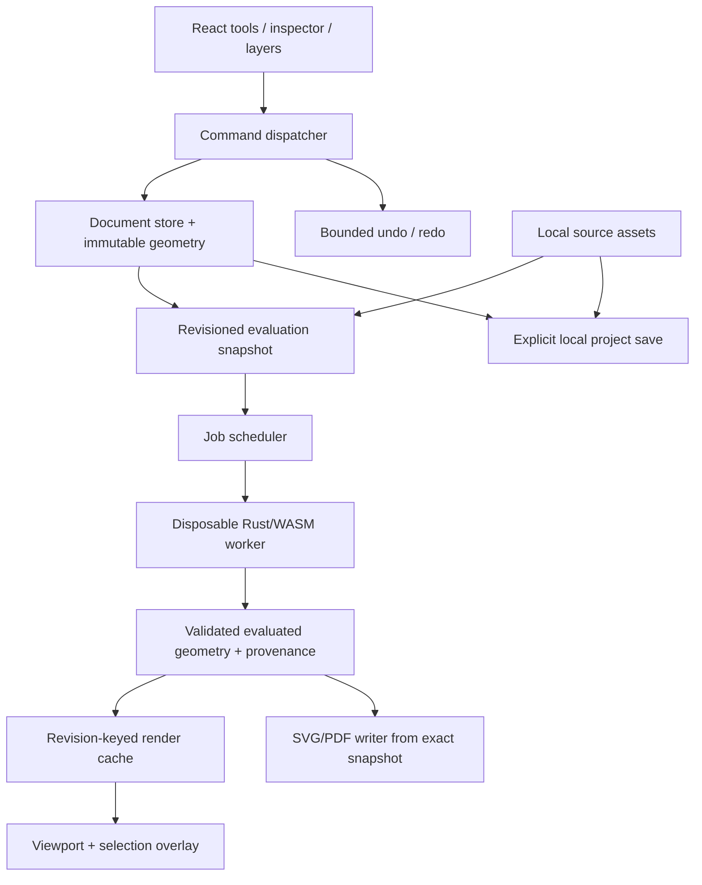

# RFC-002 — Vector Studio architecture

Status: DRAFT — independent engineering review and owner approval required; no P1 authorization.
Date: 2026-11-24. Baseline: main baf1d17972f8a06d46c0538030e2eeba75cf4354 (accepted P0, PR #3).
Scope: P1 editor foundation, explicit seams for P2–P4. Documentation only.
Inputs: [P1 handoff](P1-HANDOFF.md), [RFC-001](RFC-001.md), [PRD-002](PRD-002-VECTOR-STUDIO.md), [tools](VECTOR-STUDIO-TOOLS.md), [Creative Lab](CREATIVE-LAB.md), [technical debt](TECHNICAL-DEBT.md), [P0 acceptance](research/P0-ACCEPTANCE.md), [postmortem](research/P0-POSTMORTEM.md). Companion: [engineering review protocol](RFC-002-REVIEW.md), [design system](DESIGN-SYSTEM.md).

## 1. Decision summary

Vectra edits durable creative intent, not tracer output. A revisioned editable document is authoritative; a deterministic evaluator produces validated vector geometry; the viewport and exporters consume that geometry, not each other's output. Heavy geometry jobs run in disposable workers. No committed edit, source or undo record may exist only in a cancellable worker.

| ID | Proposed decision | Qualification |
|---|---|---|
| D01 | Main application owns committed document, immutable geometry buffers and source references; React is a view | Review memory/recovery |
| D02 | Transactional document commands, monotonic revisions, bounded structural-sharing history | Review |
| D03 | M/L/C/Z, f64 coordinates, compact typed-buffer transport; v1 scene/export adapter | Benchmark transport |
| D04 | Retained Canvas 2D with spatial index/caches as first candidate; benchmark SVG DOM and WebGL | Conditional on R02 |
| D05 | One disposable compute worker initially; explicit job scheduler and frozen snapshots | Prove lifecycle |
| D06 | Shared boundary topology belongs to trace/evaluation stage, not global mutable document constraints | R04 spike |
| D07 | Versioned typed linear effect recipes, explicit conversions, deterministic seeds, bake | P1 seam, P2 implementation |
| D08 | Minimal explicit local project Save/Open proposed for P1-C rather than P4 | Owner scope approval |
| D09 | Vite+, React, TypeScript, Tailwind CSS, shadcn/ui + Dice UI, common Base UI primitives and Lucide | Product direction; pin/audit and integration gate R05 |
| D10 | Workers Static Assets + versioned service worker retained; optional future online adapters isolated | Accepted P0 baseline |

Do not mistake an architectural proposal for evidence. No new runtime dependency is installed or qualified by this RFC. Review and reconcile these decisions before P1. No AI/ML/inference, artwork uploads, account gates, subscriptions, DRM, watermarking, paid-only engine functions or raster fallback in SVG/PDF. MIT core stays free; optional future commercial recipes use the same parser.

## 2. What exists and why it matters

Source inspected at baseline:
- crates/vector-engine/src/scene.rs: version 1, ordered groups, palette, optional background, rectangular group clip, compound paths (M/L/C/Z string plus f64 coordinates), fill/stroke, explicit fill rule. No path IDs or document transforms. Structural and anchor validation.
- packages/vector-engine-wasm/src/lib.rs: vectorize returns scene JSON, report and SVG; sceneToSvg/sceneToPdf take scene JSON.
- src/workers/protocol.ts, vectorize.worker.ts: RGBA transferred into worker, scene and SVG strings returned; PDF is separate job. src/vectorization/client.ts: one pending job, latest-wins traces, generation guards, terminate/recycle.
- src/workspace/useWorkbench.ts: source/result/settings in React state, RGBA copied for transfer, 200 ms debounce, SVG Blob image preview. PDF uses result JSON. src/vectorization/intake.ts: signature, dimensions, format/animation checks before decode.
- package.json: React/React DOM runtime, pinned local Vite+ toolchain; no UI framework beyond React yet.

Reported measurements (not rerun): [native photos](research/p0-r/PERFORMANCE-BASELINE.md) 12–24 MP colour 5–12 s, 8/28 Chromium jobs over 1M anchors, preview frame gaps 83–850 ms, WASM up to 972 MiB. [Precision report](research/p0-r-geo/FINAL-REPORT.md): opt-in Precision stacked-only, 326/326 default regression files unchanged, colour junction slivers remain. Linux arm64 verified before precision; actual Safari, mobile, amd64, lower-end device and real deployment not qualified. Preserve accepted P0 configuration and fixture hashes; no broad engine rewrite.

## 3. Architecture and module ownership



The diagram is data dependencies, not a mandate for separate workers. Initially a single compute worker evaluates geometry and writes exports; cheap interaction uses local transforms, bounds and cached draw data. Pure framework-neutral TS controller with explicit subscriptions (useSyncExternalStore or equivalent); React observes narrow selectors. No per-anchor React state or per-pointer deep document clones. Renderer draws via requestAnimationFrame and incremental invalidation. Single user, single document, one artboard initially; no CRDT, collaboration or generalized plugin host.

Separate:
1. Authoritative document intent: IDs/tree, geometry refs, transforms, styles, recipes, artboard, source refs.
2. Ephemeral session: camera, tool, selection, hover, pending previews, progress.
3. Evaluated geometry: immutable revision-keyed draw records with provenance, preview/exact quality.
4. Local asset and buffer repository: immutable payloads retained by live document, history and job snapshots; evict only unreachable/cache data.

## 4. Editable document v1 — logical schema

Not a final wire format. Document, engine, scene, recipe, protocol and persistence versions independent.

```text
Document { schemaVersion, documentId, revision, nextId, artboard,
           orderedRootIds, nodesById, paletteById, sourceAssetRefs }
Node = Layer | Group | PathObject | SourceReference
Common { id, name, visible, locked, localTransform, optionalClipRef }
Layer/Group { orderedChildIds, kind?, optionalEffectStack }
PathObject { geometryRef, fill?, stroke?, fillRule, optionalEffectStack }
SourceReference { assetId, sourceToDocument, traceProvenance? }
Geometry { immutable verbs, f64 coordinates, subpath offsets }
SourceAsset { id, digest?, mime, dimensions, decodePolicy, bytesRef?,
              provenance?, persistencePermission }
```

Invariants: acyclic ordered tree, one parent per nonroot, unique IDs, references valid, finite/bounded numbers and geometry, depth/size caps. Source reference locked by default, never export raster. Palette reference or literal fill is single colour authority; materialize validated colour in evaluated scene. Hidden nodes do not export; locked visible nodes do. Visibility/lock inherit. Clips are validated typed geometry, not raw SVG; reject missing refs/cycles. No arbitrary SVG import, text, filters or gradient claims.

IDs: monotonic document-local IDs with kind prefix, high-water mark survives undo/redo; duplicate fresh ID, undo restores original identity but increments revision. Allocate traced objects in deterministic paint order. Preserve compound paths and holes; split disconnected components only with correct containment/fill analysis. Re-evaluated recipe preserves parent identity; child IDs stable only where operation-local identity is well-defined, otherwise selection returns to parent. Retrace after edits defaults to new layer; explicit replacement is undoable. No index-based durable identity or heuristic topology matching in P1.

Coordinates: y down, source pixel units initially, f64, parent × local affine 2×3 matrices, camera/DPR separate. Reject singular/ill-conditioned inverse for editing; qualify tolerance. Keep transforms reversible and bake into evaluated coordinates; round only at serialization boundary (existing unedited P0 trace coordinates retained). Nonuniform stroke transforms require qualified outline expansion or explicit rejection; do not silently average widths. P1 filled paths first. Physical output size independent of screen zoom.

## 5. Commands and history

Pure commands: attach reference, commit trace as new layer, explicit replace, delete/duplicate, reorder/reparent, visibility/lock/name, transform, fill/palette, group/ungroup, artboard, apply qualified geometry operation. Validate before publication. Async commands capture revision, target IDs and geometry/source digests; discard stale results and errors. Conservative whole-document match initially; selective rebase later only with evidence. Drag/slider changes transient until pointer-up/Apply, one undo entry; Escape cancels. Selection/camera not document history. Undo/redo restores immutable refs and modified records rather than copying all buffers; revision monotonic, new edit clears redo. Dirty status reflects saved content identity, not just revision counter.

Proposed cap 100 transactions and 128 MiB uniquely retained history-only data (64 MiB constrained profile). Count unique geometry/asset buffers; release unreachable data. Evict oldest whole transactions with visible truncation; never evict current scene. If single command cannot fit, reject or ask before commit without history. Undo source removal must still work. Failed/cancelled trace or import leaves document unchanged. No half commits.

## 6. Evaluation, transport and export

Retain P0 scene v1 as standalone validated export format. Introduce editor-side evaluated model with stable object provenance, draw order, geometry refs, effective styles and clips. Adapt representable snapshots to v1 for P1-A; no unconditional exporter rewrite. Extend to scene v2 only for needed capability (path clips, clip stacks, qualified strokes), with explicit version validation and dual-format regression. Unedited P0 route must preserve original coordinates/metadata/hashes; edited exports have deterministic metadata excluding filenames, clocks and ephemeral IDs.

Candidate GeometryPacket v1: bounded manifest, transferable Uint8Array opcodes (M=0,L=1,C=2,Z=3), Float64Array coordinates, Uint32Array verb/coordinate offsets with sentinel, style/clip indices, bounds and object refs. Validate offset monotonicity, arity, finite coords, path grammar, ref ranges, lengths and checked byte budgets in both languages. f32 permissible only in render caches. Encapsulate mutable views; committed buffers never detached. Transfer only job-owned copies; no live WASM linear-memory views beyond call or growth. Measure actual copies through wasm-bindgen/worker/renderer; binary bridge is conditional, capped v1 JSON fallback for small scenes only pending qualification. On disk explicitly little endian if binary selected.

Trace/evaluate returns geometry + metrics without mandatory SVG text. Export only when requested, from exact frozen committed revision, visible nodes and approved physical size. Preserve existing vectorize API/harness until equivalent regressions exist. Freeze export even if subsequent edits occur; label snapshot. Preview resolution never silently exported as final; show exact versus draft and offer final evaluation or last committed result. Exclude sources, guides, selection, checkerboard, paper display tone and raster render tiles. Both SVG and direct Rust PDF consume one validated scene; no SVG→PDF conversion, no silent unsupported operations, no CMYK/PDF-X/spot-colour certification. Independent renderer and vector resource inspection remain mandatory.

## 7. Renderer and selection — conditional decision

Retained Canvas 2D first candidate: cubic paths/fill rules, no one DOM node per path, simple viewport overlay and caching. Benchmark it against SVG DOM (including grouping), a small WebGL tessellation candidate (holes/compound fill/alpha/clips), and P0 SVG-image reference. Do not develop three production renderers. Renderer-independent port: attach/resize, setSnapshot, invalidateObjects, setCamera, drawOverlay, release; hit-test service separate. No renderer types in document or exporters.

Use conservative transformed bounds including stroke/clip extents; cull viewport-invisible items, preserve paint order. Candidate spatial grid or R-tree, measure updates and degenerate cases. Cache path representation by immutable geometry/style; invalidate affected descendants only. Pan/zoom never retraces. Bound DPR, viewport, path/tile/GPU memory. Optional raster display caches or LOD are labelled temporary; exact view on idle/high zoom and exact geometry for selection/export. Context loss recover from committed snapshot. Chunk expensive build/index/render work; do not block first feedback waiting for entire scene.

Hit tests: inverse camera, screen tolerance in document units, spatial candidates, fill rule/holes, strokes and clips, back-to-front. Respect visibility and inherited lock; alpha-zero not selectable in Artwork view; Paths view explicit outline policy. Layer panel may select locked node for unlock only. Scope object/group/layer, multiselect, cycle overlapping objects, marquee documented containment vs intersection (bounds initially, no pixel-perfect claim). Never scan all anchors each pointer event. Accessible layer tree and keyboard equivalents independent of canvas. Selection overlay/handles do not export. Benchmark large single compound paths as well as many small paths; indexing objects alone is insufficient.

## 8. Worker lifecycle, decoding and scheduler

Extend protocol with version handshake, generation, jobId, document revision, source revision/digest, target IDs/digests, operation versions, quality, progress or indeterminate state and typed result/error. Controller validates response token/kind before commit. Late messages/errors dropped. Worker never owns only copy of committed data; caches/handles disposable. Crash/recycle reconstruct from snapshot; offline recovery uses existing service-worker asset cache.

One compute worker initially. Explicit Apply/final/export higher priority than same-scope latest-wins preview; later thumbnails lowest. Preview must not silently cancel export. Queue bounded; visible status/cancel, frozen export snapshot and memory reservation. Terminate active synchronous WASM on cancel; reject active job, requeue only still-valid explicitly safe pending jobs, no half result. No SharedArrayBuffer/COEP or pool requirement until measured. Retain existing strict CSP/versioned cache; no new remote origins. Test cancel, stale results/errors, undo while busy, worker crash/recycle, offline export/update.

Browser decoding initially unchanged. Local original Blob retained under aggregate cap; normalized RGBA cache evictable. Preview downsample explicit and labelled, scale parameters in source units (speckle area/pitch/threshold) and map coordinates back; do not auto-commit draft. Exact final at approved resolution. Reproducibility: identical normalized RGBA, settings, versions, seed; JPEG/premultiplication browser differences disclosed. WASM decoder evaluation separate, including PNG/JPEG/WebP, EXIF/ICC/alpha, security, size/licences; don't switch P0 defaults silently. No raw decoded pixels persisted by default.

## 9. Geometry and shared boundaries

TD-GEO-001/009: independent region fitting causes lower-layer slivers and junction irregularities. Retain Artistic and Precision stacked defaults. Proposed trace-local subdivision: labelled faces, oriented shared boundary edges, junction vertices; fit shared edge once and use exact reversal for neighboring face (cubic control swap). Recover antialias subpixel information where identifiable, keep uncertainty, no invented occluded geometry. Validate closed cycles, adjacency, opposite orientation, holes, duplicate/dangling edges, self-intersections and expected coverage. Stacked may overlap intentionally; mosaic partitions should not. Raster antialias seams can arise on coincident edges; distinguish rendering artifacts from actual geometric slivers. Compare lower-cost label/blend correction + local edge fitting vs full graph in R04. No blanket snapping/erosion/offset.

Materialize independent editable paths at commit; shared topology is evaluation-local, optional provenance not mandatory global linked edges. Moving one object must not unexpectedly move neighbor. Future ink plates share initial separation but can deliberately misregister; distinct ink plates are not constrained to same boundary. Booleans/offset/smooth/simplify separate geometry operations behind Rust API, not VTracer types. Arbitrary clips require explicit consistent preview/export contract, bounded nested intersection and clip transforms; P1-A retains rect clip adapter, P2-A or earlier only after qualification.

Maintain IoU alongside analytic radial, deviation, corner/tangent and topology metrics; no threshold lowering. Tier/metric amendments require owner ratification. Reproduce 04/22 sliver coords and held-out shapes, ring/hole and negative organic controls; protect Artistic bytes. P1-C separate geometry gate for shared boundaries, thin bars, acute corners and straight edges. Line Art centerline/thin-feature work separate; hard-mask sampling and partial alpha debt may remain deferred.

## 10. Effects, recipes and printing press

P1 command/operation descriptor seam only, not full effect graph. Ordered typed domains: Raster → TonalField/LabelField → VectorGeometry → InkPlates (declared branches/conversions). Copy of a Copy operates on tone before trace; Halftone synthesizes geometry; Distress subtracts shapes; Recolor changes style; Registration transforms plates. No implicit rasterization between vector operations. Operation ID/version, input/output domain, parameter schema/units/defaults/ranges, deterministic seed/version, topology impact, resource estimate, cancellation and export capability. Rust authority for geometry operations, generated or checked TS metadata; never user-executable scripts.

Future stack on layer/group/object with immutable base; reorder only compatible stages, disable only if downstream valid. Cache key includes source/base digest, operation/version/parameters, seed, engine/decode policy, quality, relevant transform; bounded LRU, disposable. Compare then Apply atomically; bake materializes result and clears stack in one undoable transaction, retains base via history. Node edit chooses base or explicit bake. Variation Lab samples same immutable snapshot, stable seeds/parameter locks, actual sampled parameters stored, bounded concurrency and explicit apply.

Future .vectra-preset envelope: schemaVersion, id/version/name, creator/licence, compatible engine range, remix attribution, ordered typed operations and seeds; no artwork, secrets, executable code or external resource inputs. Strict unknown rejection/migrations, deterministic ordering. Same free and paid format; no DRM. P1 trace provenance uses existing TraceRequest version, not generic recipe engine. Ink plates named ordered groups + colour identity, reversible registration; actual vector background optional separate from display paper. Overprint simulation only via qualified vector representation; no raster blend fallback or print certification.

## 11. Persistence and security

Propose minimal explicit Save/Open .vectra in P1-C instead of P4 (owner decision): preserve edited geometry and identity without retracing. P1-A schema/snapshot design, P1-C qualify bounded manifest plus geometry and optional permitted original sources. File chooser/download works offline; OPFS/IndexedDB/autosave opt-in later. No private artwork automatically stored. If slice deferred, show unsaved warning and export; no claim full project workflow.

Candidate bounded archive or simpler bounded container; select after R05. Manifest: schema/engine versions, document tree, palette/artboard, geometry descriptors, source metadata; binary geometry little endian if selected, permitted raster assets internal IDs, no arbitrary filenames. Bound compressed/uncompressed size, entry count, depth, geometry, pixels, duplicates, traversal, absolute paths, hashes and allocations before commit; reject scripts/active markup, external refs and unknown versions. Stage then atomic swap; error leaves existing project. Optional source inclusion; without source, traced geometry remains editable/exportable and source-dependent operations disabled with explanation. Respect future provider persistence restrictions. Initial history not persisted; reopen empty history with clear disclosure. Migration deterministic, never overwrite original file automatically.

Security: preserve strict CSP and asset-only service worker; no remote font/CDN assets, analytics, artwork logs or persistence without permission. Optional online features later explicit separate adapters/config with narrow CSP and API routes, provider attribution/download tracking/policy review, no provider asset caching by SW unless allowed. No domain hardcoding. Workers Static Assets; deploy deferred. MIT and regenerate complete third-party notices for any distributed dependency or copied component.

## 12. Design system and UI (D09)

Adopt [design system companion](DESIGN-SYSTEM.md): shadcn/ui as base components, Dice UI as extension registry, Tailwind CSS and shared Base UI primitives (prefer Base variant, review compatibility), Lucide icons. Vectra owns semantic tokens and copied source, not vendor default look. Keep artwork renderer, geometry, command model and scheduler independent of UI libraries. Custom viewport and tool interactions; component libraries only for app chrome, forms and interactions where appropriate. Design system integration is an explicit review spike; pin exact versions/registry snapshots, check React/Vite+ compatibility, CSP, licenses, bundle and accessibility. Do not install libraries in this docs PR.

Desktop charcoal/lime workspace per PRD-002: top project/import/history/export bar, compact left rail, central viewport, contextual right inspector/layers, bottom zoom/status. Artwork/Paths/Compare synchronized camera; optional source reference; controls with numeric input, units, reset, Apply/Cancel, keyboard focus/shortcuts with text-input guards, no color-only status. Tools Select, Trace (Artistic/Precision), Smooth, Simplify, Cleanup, Recolor; nodes/booleans/offset P2-A. Optional photo browser/Press/Variation later; hide or explain unavailable tools. No fake controls. Mobile later after evidence.

Suggested modules src/document (commands/history/asset/geometry), evaluation (adapter/snapshot/cache/operation descriptors), workers (protocol/client/scheduler), renderer (camera/index/backend/overlay), workspace (controller/tools/inspectors/layers), components/ui (owned registry components), components/editor (domain wrappers), projects, export, presets, styles. Keep Rust trace adapter, validated scene and writers independent. React store selectors; Zustand optional only if need proven, no premature framework replacement. Paper.js/Kurbo/Clipper2 candidates not approved. Preserve engineering harness/tests, remove fault-injection hooks from eventual public UI. No speculative monorepo split.

## 13. Provisional performance and resource budgets

Owner ratification needed. Reference M5 Max, proposed lower-end 8 GB M1 or 2020–21 mainstream 4c/8t laptop. CPU throttling not worker speed evidence. P0 guardrails: 20 MiB compressed input, 12 MP default, 16,384 side, 50 MP engine ceiling engineering-only, 1M default anchors (5M hard engine limit), recycle >1 GiB WASM. Product P1 cap 1M anchors, warn ~250k, 12 MP desktop default / proposed constrained 8 MP colour. No silent downsampling/dropped geometry; explicit reduce resolution/detail or increase pitch. Reserve aggregate document assets, committed geometry, retained history, job copies, worker heap, render cache and export buffers before allocation. Lower-end 512 MiB worker / ~2 GiB tab candidate, not guaranteed browser limits. Track estimates vs measured; release cancelled jobs. Early cost estimate after segmentation, before expensive fitting, no unjustified false positive reject.

| Metric | Proposed gate on reference hardware |
|---|---|
| B&W import→visible | ≤0.5 s at ~1 MP; ≤2.5 s at native 24 MP engineering workload |
| Colour/limited final | ≤8 s native 12 MP, cancel/progress; predictable over-budget cases within 2 s where feasible |
| Processing responsiveness | no attributable frame gap >50 ms; cancel acknowledgement ≤200 ms |
| Interaction | p95 frame ≤33 ms initial, 16.7 ms aspirational; no attributable >50 ms stalls on defined workloads; preview ≤100 ms for ≤250k anchors |
| Hit test | p95 ≤8 ms typical indexed query at 250k; ≤16 ms stress candidate |
| Large scenes | 250k interactive target, 500k/1M stress; responsive cancel and explicit degraded display only |
| History | 100 transactions / 128 MiB unique retained-only data; constrained 64 MiB |

Freeze workloads, viewport/DPR, repetitions and cold/warm before runs. Report p50/p95/max, decode/worker/transport/index/paint/input-to-visible/export and aggregate memory, no averaging away worst gaps. If none meet target, propose smaller interactive cap or staged rendering and owner-approved scope adjustment. P0 misses not rewritten as pass. Benchmark real lower-end device before public support claims.

## 14. Delivery gates

Review R00–R05 in companion; independent engineering review and owner approval first. Do not lock renderer-specific data structures into P1-A while decision pending.

| Phase | Deliverables | Exit |
|---|---|---|
| P1-A | document/commands/history, immutable asset/geometry store, trace commit/snapshot jobs, IDs, test harness | invariants/fuzz, atomic undo, cancellation/crash/detach offline, limits, unedited P0 bytes, replace/new layer |
| P1-B | qualified renderer, camera/hit tests, shadcn/Dice workspace, layers and transform UI | performance evidence, keyboard/locks/holes, owner visual review, actual Safari test or explicit support restriction, privacy/offline regression |
| P1-C | Artistic/Precision Trace, Smooth/Simplify/Cleanup/Recolor, exact export, proposed Save/Open slice, core preset qualification, geometry debt slices | analytic/visual regression, vector-only export, project round trip if included, unchanged Artistic baseline |
| P2-A | nodes/handles, booleans/offset, arbitrary clips | topology, geometry and export gates |
| P2-B | typed effects, reorder/bake/versioned recipes | compatibility, deterministic cache, undo |
| P2-C | Print/DIY Underground, limited ink plates, initial Variation Lab and recipe sharing | owner artistic review, bounded worker/export |
| P3/P4 | advanced patterns/glitch/brushes, collage, print preview, batch, persistence extensions | separate evidence |
| Post-core/post-V1 | optional image/community services; premium content | policy/licensing/security gates; no editor dependency |

Core presets B&W, Full Color, Limited Color already proven; Grayscale, Silhouette, Line Art qualify separately, explicit deferral if needed. Artistic/Precision fitting not presets. Old Print feasibility not finished feature. Shared-boundary switch not implicit, precision mosaic only after gate. No public deploy until UI, owner approval, notices, actual HTTPS verification and supported-browser disclosure. Cheap local pinned checks; optional/manual or path-filtered CI after owner cost decision, no auto benchmark matrix.

## 15. Reconcile R1–R9

From [P0-R reconciliation](research/p0-r/ARCHITECTURE-RECONCILIATION.md):
- R1 Workers Static Assets accepted, Pages alternate only.
- R2 phased PRD-002 supersedes original monolithic P1; explicit Save/Open moved earlier as proposal.
- R3 charcoal/lime contextual rail design supersedes earlier preset gallery-first shell; keep ivory preview and accessibility.
- R4 core and Print/DIY Underground/Advanced taxonomy; three proven modes plus separate qualification of remaining core modes.
- R5 shadcn/ui + Dice UI + Tailwind + Lucide proposed, common Base UI, no dependency adoption until integration review.
- R6 retain IoU plus analytic metrics; tier amendments pending owner, Precision distinct from approved Artistic.
- R7 deterministic per identical normalized RGBA and versions/seed, cross-browser decode differences disclosed.
- R8 isolated later online-enabled adapter/build CSP; current offline build unchanged.
- R9 module structure in §12.

Debt mapping: TD-GEO-001/007/009, TD-PERF-001/003, TD-ARCH-001/002/003 explicitly shape this RFC; TD-PERF-002/004 and TD-ARCH-004 P1-A/B; TD-GEO-003/004/005 P1-C/Line Art; TD-PLATFORM-002/003 P1-B/device budget. Remaining IDs retain original register dispositions unless separately accepted. No debt closure claimed.

## 16. Owner decision points

Accept/revise D01–D10 after independent review. Explicitly decide performance budget/lower-end device, metric amendments, P1 Save/Open scope, core preset sequence, CI cost policy and canonical Linux build for published hashes. No choice of domain or release date. Claude to critique this RFC and run bounded experiments; report contrary evidence and stop. Reviewer may propose changes, not merge or implement P1. Author reconciles; owner approves; then P1-A prompt.

All gates in this RFC NOT RUN; source inspection and historical reports only.
