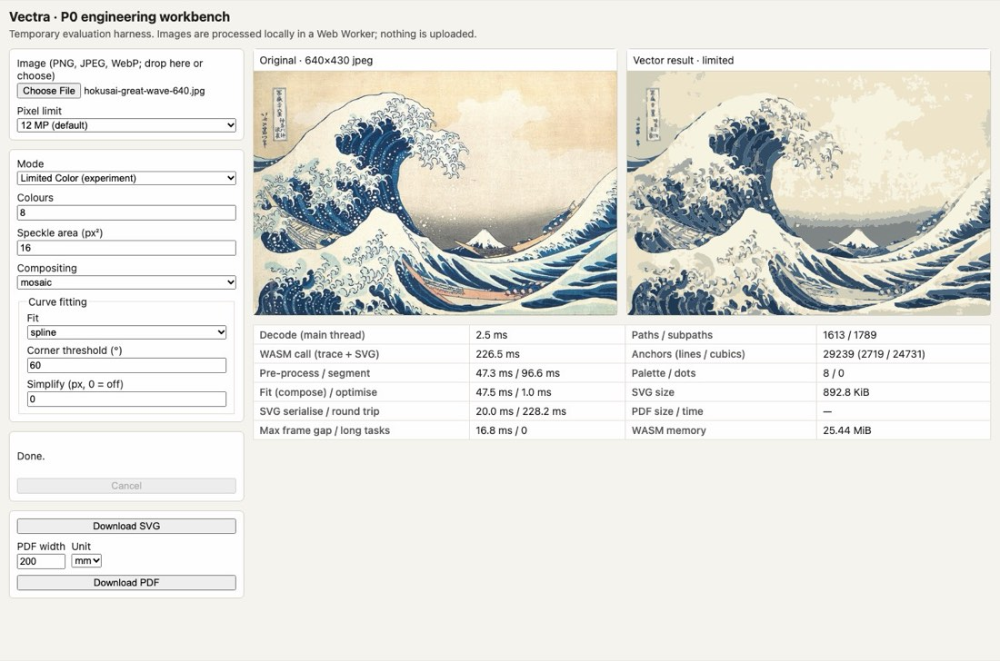
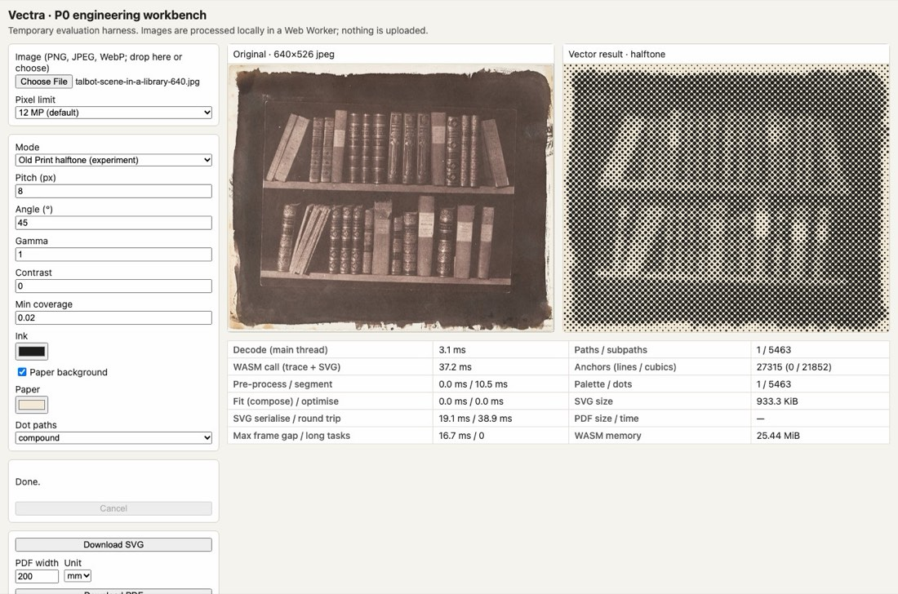

# P0 final report: browser vectorization feasibility

Date: 2026-11-23 · Branch: `p0/technical-feasibility` (not merged) · Machine: Apple M5 Max, macOS 26.6.2

## 1. Executive summary
The architecture in RFC-001 is feasible in real browsers. A pure-Rust engine compiled to WASM (wasm-bindgen 0.2.130) runs in a module Web Worker under a strict CSP in Chromium, Firefox and WebKit. It traces Black & White, Full Color and Limited Color. It also synthesises vector halftones for the Old Print spike.

Every output path goes through one validated, versioned scene, and both exports come from it:
- **SVG:** allowlisted and raster-free.
- **PDF:** a direct pdf-writer file. qpdf, pdfimages and a poppler-vs-resvg render comparison confirm that every PDF is vector-only with exact page size.

No network traffic happens after start-up, and the full workflow runs offline. Desktop performance is well inside the proposed thresholds up to 24 MP.

Five decisions deviate from the baseline. Each is evidenced and recorded in RFC-001:
1. VTracer **1.0.0-alpha.4** instead of 0.6.5.
2. A direct PDF writer instead of jsPDF + svg2pdf.js.
3. Scene commands limited to M/L/C/Z.
4. Terminate-and-recreate cancellation.
5. Vectra-owned alpha and luminance policy.

**Recommendation:** proceed to P1 after the maintainer reviews the deviations and the items listed in section 14.

## 2. Gate status matrix
| Gate | Status | Basis |
|---|---|---|
| Documentation review | Done | DOCUMENTATION-REVIEW.md (12 findings, recorded before code) |
| P0-G0 Toolchain | **PASS** (macOS). Linux **NOT RUN**. | Clean clone, `vp install`, `vp dev`, `vp check`, `vp test`, `vp build`. WASM byte-identical across checkout paths (SHA-256 `9bc2cd9e…`). |
| P0-G1 Vectorization | **PASS** | 25 Rust tests. Real-browser tracing of 13 fixture/mode cases in 3 engines. IoU target missed on 2 shapes; diagonal 1-px strokes lost (both documented). |
| P0-G2 Worker | **PASS** | Typed protocol; cancel ≤ 53 ms visible; stale results dropped; crash/abort recovery; memory flat over 20 imports |
| P0-G3 Export | **PASS**. Viewer and Inkscape round-trips **OWNER TEST PENDING**. | 78 native + 12 browser PDFs: 0 images or XObjects or fonts; MediaBox ±0.1 pt; render diff ≤ 0.93/255 at 300 dpi |
| Old Print spike | **PASS** (feasibility) | Tone→area error ≤ 2.5 %; overlap-correct nonzero fill; raster-free exports |
| P0-G4 Cloudflare Pages | **PARTIAL**. Deploy **OWNER TEST PENDING**. | Static build + `wrangler pages dev`: headers, `application/wasm`, CSP enforced (negative control) |
| P0-G5 Privacy/perf | **PARTIAL** | 0 requests during the session in 3 engines; offline workflow passes. WebKit cannot recover from an offline cancellation. Safari, iOS and mobile **NOT RUN**. |

## 3. Technology stack (exact versions)
- **Node toolchain:** Node 24.22.1 · pnpm 12.23.0 · **Vite+ 1.7.0**, which bundles:
  - Vite 8.3.8 (`@voidzero-dev/vite-plus-core@8.3.8000`)
  - Rolldown 1.2.19
  - Vitest 5.1.0
  - Oxlint 1.94.0
  - Oxfmt 0.79.0
  - tsrs 7.1.0-beta
- **App:** TypeScript 7.0.2 · React 19.3.1 · `@vitejs/plugin-react` 6.3.0.
- **Rust:** 1.96.0 · wasm-bindgen 0.2.130 (crate and CLI) · vtracer =1.0.0-alpha.4 · visioncortex =0.9.3 · pdf-writer =0.15.0 · miniz_oxide 0.9.1 · serde 1.0.229 · serde_json 1.0.154.
- **Testing:** @playwright/test 1.65.1, with Chromium 159.0.8154.6 headless shell, Firefox 159.0 and WebKit 27.2 · resvg 0.50.0 and png 0.18.1 (dev).
- **Evaluation only:** jspdf 4.2.1 and svg2pdf.js 2.9.0 (dev).
- **External tools:** qpdf 12.4.2, poppler 26.11.0, wrangler 4.166.0.

## 4. VTracer evaluation and recommendation
- Both 0.6.5 and 1.0.0-alpha.4 compile to wasm32 (122 KB and 139 KB) and give the same geometry and speed on the probe fixtures.
- Both share a transparency defect: a transparent hole off the five sampled rows is filled (leak 1.0).
- 0.6.5 also thresholds on the red channel only and drags in clap 2 and image 0.23.
- 1.0's stage API and `VectorDoc` IR let Vectra own the pre-processing and map directly onto the scene. With our alpha keying, leak drops to ≤ 0.0087.

**Recommendation:** keep 1.0.0-alpha.4, pinned exactly, behind `trace.rs`. Re-evaluate at 1.0 stable. Fallback: visioncortex directly (a reported substitution). Details: P0-G1.

## 5. SVG and PDF verification
**SVG:**
- Allowlist of 7 elements and 18 attributes (17 seen in browser output).
- No image, script, foreignObject, href, style or data URIs (Rust and browser DOMParser checks).
- `viewBox = 0 0 W H`; explicit fill rules.
- Holes preserved (probe-tested).
- Transparent backgrounds stay transparent.

**PDF:**
- `qpdf --check` clean.
- A `qpdf --json` scan of every object found no `/Image`, `/XObject`, `/Font`, `/Pattern`, `/Shading` or JS.
- `pdfimages -list` empty.
- Operators limited to `q Q cm gs rg RG w m l c h re W n f f* S B B*`.
- MediaBox matches mm/in/pt/px conversions to ±0.1 pt.
- Poppler render vs resvg render of the SVG: 32-px block mean ≤ 0.93/255 at 300 dpi on all 78 samples.

**jsPDF + svg2pdf.js** (evaluated in all 3 engines):
- Raster-free, but 2–3.5× larger.
- Adds 14 font references and an empty XObject dictionary.
- Writes a timezone-bearing CreationDate.
- Needs main-thread DOM.
- Not adopted.

Details: P0-G3.

## 6. Old Print findings
- The scene represents rotated, variable-area dot screens.
- Overlap beyond π/4 is handled by exact area inversion with a nonzero union. Even-odd measurably punches holes, losing 16 % of ink in the darkest band.
- Ink and paper colours work; the paper can be omitted for transparency.
- Output is deterministic, and a primitive guard refuses oversized output.
- Compound path vs per-dot: 26 % smaller SVG.
- About 80k anchors gives about 3 MB SVG and 0.9 MB PDF.

Needed for P2:
- general path clips (alpha and ink shapes);
- multi-ink groups;
- contour ink;
- seeded distress.

Details: OLD-PRINT-FEASIBILITY.md.

## 7. Performance summary
Medians, Chromium / Firefox / WebKit:

| Measure | Result |
|---|---|
| 1 MP colour | 558 / 518 / 412 ms |
| 4 MP colour | 1.50 / 1.23 / 1.18 s |
| 24 MP colour | 3.3 / 2.8 / 2.4 s |
| 24 MP limited | 5.9 / 5.9 / 5.0 s |
| WASM init | 3–8 ms |
| Decode at 24 MP | 53–88 ms |
| PDF at 24 MP limited | ≤ 1.23 s |
| Peak WASM memory | 913 MiB |
| Main-thread frame gap | one frame, except a single 52 ms WebKit sample |
| Long tasks (Chromium) | 0 |

All proposed desktop thresholds are met. Sources were upscaled photographs, so these figures are optimistic. Full tables: BENCHMARKS.md.

## 8. Privacy verification
- Request interception covered page and workers in 3 engines, under `vp preview` and `wrangler pages dev`.
- Load fetches 5 same-origin GETs.
- **0 network requests** during import, 4 traces, a setting change and both exports.
- No request bodies; no filename, settings or bytes in URLs.
- The offline session passes in all three engines.

Details: P0-G5.

## 9. Cloudflare Pages readiness
- `dist/` is static: 6 files, largest 484 KB.
- `_headers` sets the CSP (`'wasm-unsafe-eval'` is required, as the negative control proved), security headers and `immutable` asset caching.
- `wrangler pages dev` serves `.wasm` as `application/wasm` and applies all headers.
- Pages v3 Git builds lack Rust and pnpm 12, so the recommendation is a local or pinned-CI build plus `wrangler pages deploy`. Also consider Workers Static Assets.
- Real deploy: **OWNER TEST PENDING**. Details: P0-G4.

## 10. Licensing
- The shipped JS is React (MIT).
- The shipped WASM is permissive: mostly MIT/Apache-2.0, plus **flo_curves (Apache-2.0 only)** and **roots (BSD-2-Clause)**. Both require notices, so generate THIRD-PARTY-NOTICES in P1.
- Dev-only MPL-2.0 (lightningcss) is not distributed.
- Poppler (GPL) is an external tool only.
- Fixtures are procedural, or public-domain/CC0 (Met via Wikimedia Commons).
- No LICENSE file was added; that remains the maintainer's decision. Details: DEPENDENCY-LICENSE-AUDIT.md.

## 11. Known defects and architectural risks
1. **VTracer 1.0 is alpha**, with a single maintainer and fast-moving master (exact pin plus adapter).
2. **Cross-browser determinism:** WebKit's JPEG decode and premultiplied canvas alpha change the RGBA input. In-WASM decoding is a P1 option.
3. **Offline cancel recovery fails in WebKit.** Fix with a service-worker precache or a standby worker.
4. 1-px diagonal strokes are lost (4-connected ink). Thin-ring and star IoU is 0.975–0.977, below the 0.98 target. Partial alpha is binarised.
5. Large outputs: 24 MP limited colour gives 555k anchors and a 22 MB SVG. The post-result preview paint cost is unmeasured.
6. WASM memory never shrinks. The worker is recycled above 1 GiB. Mobile memory limits are unknown.
7. Linux build, real Safari, iOS and Android, Inkscape and viewer round-trips, and a real Pages deploy were **not run**.
8. `base: "./"` breaks deep links if routes are added.
9. Some unrelated maintenance on this machine: Homebrew `qpdf` and `poppler`, the Rust 1.96.0 wasm32 target, `wasm-bindgen-cli` 0.2.130 and Playwright browsers were installed. No global Vite+ was installed.

## 12. Run the engineering workbench locally
```bash
cargo install wasm-bindgen-cli --version 0.2.130 --locked   # once; rustup reads rust-toolchain.toml
pnpm install
pnpm run wasm
pnpm exec vp dev            # open http://localhost:5173, drop an image, pick a mode
```
Production-like run: `pnpm run build && pnpm exec vp preview`, then open http://localhost:4173. Browser tests: `pnpm exec playwright install chromium firefox webkit && pnpm exec playwright test`. Benchmarks: `BENCH=1 pnpm exec playwright test tests/browser/benchmark.spec.ts`.




## 13. Branch, commits, PR
Branch `p0/technical-feasibility`, based on `main@15f9e00`. The commit list and PR URL are in the PR description; this file is part of the PR.

## 14. Recommendation on P1
**Proceed to P1**, conditional on the maintainer:
- accepting or rejecting the deviations in RFC-001 (VTracer 1.0-α, direct PDF writer, scene v1 command set);
- choosing the license and NOTICE approach;
- running the OWNER TEST PENDING items: a Pages deploy (or Workers Static Assets) and viewer/Inkscape checks.

Suggested early P1 items:
- in-WASM decoding (cross-browser determinism, alpha fidelity);
- a service-worker precache (offline robustness in WebKit);
- an 8-connected or centerline option for line art;
- general path clips in the scene (needed for Old Print/Screen Print);
- a primitive-budget UX;
- a Linux CI job (one workflow: install, wasm, check, test, cargo test, build);
- device benchmarks on real Safari, iOS and Android using owner-provided high-resolution licensed photographs.
