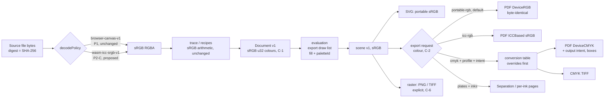

# R-COLOR — Colour architecture proposal

Status: **proposal for owner review**, 2026-11-25. Nothing here is implemented, approved or authorised. Evidence: [CURRENT-COLOR-ARCHITECTURE](CURRENT-COLOR-ARCHITECTURE.md), [ICC-ENGINE-EVALUATION](ICC-ENGINE-EVALUATION.md), [VECTOR-PDF-COLOR-OUTPUT](VECTOR-PDF-COLOR-OUTPUT.md), [PRINT-PROVIDER-REQUIREMENTS](PRINT-PROVIDER-REQUIREMENTS.md).

## 1. Recommendation

**Keep an sRGB working document.** Declare it normatively, and make every print colour space an **export-time** product of an explicit profile, intent and override list.

- Add an optional **ink descriptor on palette entries** only when spot inks are built (Document v2, additive).
- Do not introduce document working spaces (approach B) or a generalised colour type (approach C).

This is approach **A** of [CURRENT-COLOR-ARCHITECTURE §6](CURRENT-COLOR-ARCHITECTURE.md), plus the narrowest useful slice of C.

**Is an RGB working document enough for the first professional print workflow? Yes, on this evidence:**

1. **Most of the audience needs sRGB anyway.** The services closest to it (garment and poster print-on-demand) ask for sRGB or RGB raster files and convert to CMYK themselves.
2. **Conversion is cheap for flat colour.** Vectra paints only flat colours with constant alpha, so export-time conversion costs one table entry per distinct colour. The prototype scene had 11.
3. **Conversion fits the existing writer** without touching geometry (prototype: identical path operators).
4. **What an sRGB document cannot express is handled by explicit per-palette-entry overrides.** That covers exact device values for brand colours, K-only black, unprinted white and spot inks. It needs no new colour type in the document.

## 2. Normative statements proposed

The amendment text is in [PROPOSED-RFC-AMENDMENTS](PROPOSED-RFC-AMENDMENTS.md).

| ID | Statement | Changes bytes? |
|---|---|---|
| **C-1** | Every `u32` colour in GeometryPacket v1, Document v1 (including TraceProvenance colours), scene v1, snapshots and the export draw list is **sRGB (IEC 61966-2-1), 8-bit encoded, straight (non-premultiplied) alpha**. How the preview composites alpha (source-over in encoded sRGB) is informative only: exported compositing depends on the viewer or device (measured) | no |
| **C-2** | Output colour (space, profile, intent, overrides, page boxes) is a property of the **export request**. Document v1 stores no device values, profiles or print settings | no |
| **C-3** | The default export is **portable RGB**: SVG as today; PDF DeviceRGB, MediaBox only. It stays byte-identical to the frozen hashes (326 + 72, 636) | no (that is the point) |
| **C-4** | A profile-managed export requires an explicit source space (sRGB), a validated destination profile identified by SHA-256, a rendering intent and an engine identity. It runs in the compute worker, quantises device values to an integer grid, and writes an export report. There is no default CMYK profile | n/a (new path) |
| **C-5** | Conversion is per **distinct effective colour** of the export draw list, with `paletteId`-keyed overrides applied first; alpha is unchanged. The blending-space consequences of translucency are disclosed by preflight | n/a |
| **C-6** | Raster export is a separate, explicit format with stated pixel dimensions; never a fallback | n/a |
| **C-7** | No export writes a PDF/X version key, or uses the words "PDF/X", "print-ready" or a provider's name, until the qualification steps of [PDFX-FEASIBILITY §6](PDFX-FEASIBILITY.md) pass for that configuration | n/a |
| **C-8** | `decodePolicy: "browser-canvas-v1"` means the browser's own handling of embedded profiles (engine-, platform- and preference-dependent, measured). Untagged sources are assumed sRGB | no |

## 3. Pipeline (proposed; existing parts unchanged)



## 4. Export contract (sketch for the P2 gate; not for G-EXP)

```text
ExportRequest {
  format: "svg" | "pdf" | "png" | "tiff" | "jpeg",
  page?:  { width, unit, dpi?,                              // existing PdfOptions
            bleed?: { value, unit }, marks?: "none" | "crop" | "crop+registration" },
  color:  { kind: "portable-rgb" }                          // default; today's behaviour
        | { kind: "icc-rgb" }                               // ICCBased sRGB, generated sRGB profile
        | { kind: "cmyk", profile: { digest, bytes /* transferred */ }, intent: "relative" | "perceptual",
            overrides: [ { paletteId, cmyk?: [c,m,y,k], kOnly?: true, noInk?: true } ],
            backgroundIsPaper: bool, translucency: "warn" | "group-cmyk" }
        | { kind: "plates", inks: [ { paletteId, inkName } ], registration: bool },
  raster?: { ppi, alpha: "keep" | "flatten", paper?: u32 /* sRGB */ }
}
ExportResult { bytes, report: { engine, engineVersion, profileDigest?, intent?, overrides, tacMax?,
                                outOfGamut?, translucentItems, pixelSize?, warnings[] } }
```

- **Rust side.** `pdf::to_pdf(scene, &PdfOptions)` stays as it is for the default path. A new entry point takes a paint mapping and page options. The protocol is internal (single-build sessions, RFC-002 §15.3), so `protocolVersion` simply increments. Nothing is persisted.
- **Deliberately absent from G-EXP.** G-EXP should not add the colour field speculatively. The decision it needs is C-2 and C-3 (§5).

## 5. Decide now versus defer

| Decision | Now (before G-EXP and the Document v1 release) | Why |
|---|---|---|
| Document colours are sRGB, straight alpha (C-1) | **now, text only** | It removes the one real ambiguity in C10 without moving any golden file. Deciding later is just as cheap in bytes, but every consumer written in the meantime may assume something different |
| Output colour belongs to the export request (C-2) and the default stays byte-identical (C-3) | **now, as G-EXP scope guidance** | G-EXP freezes the packet-route export. Keeping colour out of the document and out of scene v1 is what makes P2 additive |
| Keep `paletteId` in the export draw list (C8, AM-1) | **now: keep, do not optimise away** | It is the override seam for K-only black and spot inks |
| `browser-canvas-v1` documented as browser-defined (C-8) | **now, text only** | It sets reproducibility expectations honestly |
| Working-space field, profile references, ink descriptors in the document | **defer to v2** | Additive, with the deterministic migrations "absent → sRGB" and "absent → process". Nothing in v1 is lost by waiting |
| Profile section in `.vectra` | **defer** | Needed only for embedding profiles in projects; that is a redistribution question |
| CMM choice (moxcms vs Little CMS) | **defer to the P2 dependency gate** | Needs registered profiles with per-intent tables and provider tests |
| Raster renderer dependency (resvg/tiny-skia) | **defer to the P2 raster gate** | New production dependency, owner approval |
| PDF/X validator procurement | **defer** | Commercial tool; owner decision |
| Physical print sizes stored in documents | **defer (v2 export presets)** | The export dialog asks; nothing in v1 depends on it |

## 6. Risks carried by this architecture

- **Preview ≠ CMYK print for translucent overlaps.** Measured 11.9–19.1 ΔE00 on saturated 50 % overlaps. Mitigation: a CMYK soft-proof composite, a preflight warning, and later vector flattening.
- **Engine determinism is per target.** f32 paths differ between native aarch64 and WASM. Mitigation: integer quantisation, export conversions in the WASM worker only, cross-target tests with a stated tolerance.
- **The sRGB gamut limits the source.** Wide-gamut sources (P3, Adobe RGB) are clipped to sRGB at decode. For process CMYK this usually matters little: typical coated CMYK gamuts lie largely inside sRGB, with exceptions in the cyan–green region (general knowledge, not measured here). It is a deliberate simplification; approach B is the documented upgrade path.
- **The engine has gaps** (BPC, gamut check, ink limiting with moxcms). Mitigation: Vectra-owned checks; Little CMS as the reference; re-evaluate at the gate.
